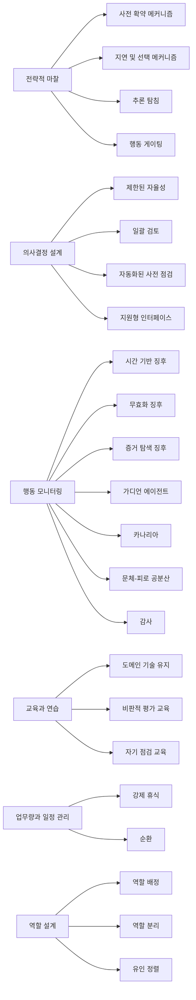

# AI 에이전트는 인간을 루프 밖으로 밀어낸다

> **원제**: *AI Agents Push Humans Out of the Loop*
> **저자**: Margaret Mitchell (Hugging Face), Avijit Ghosh (Hugging Face), Samir Passi (Data & Society)
> **출처**: [arXiv:2608.23642](https://arxiv.org/abs/2608.23642) v4 (2026-11-12 개정, 최초 제출 2026-08-24) · NeurIPS 2026 Position Paper Track 채택
> **라이선스**: 원문은 [CC BY 4.0](https://creativecommons.org/licenses/by/4.0/)으로 공개되어 있으며, 이 문서는 그 조건에 따라 원문을 한국어로 옮긴 번역본이다.

**번역 안내**

- 이 문서는 원저자가 검토하거나 승인한 공식 번역이 아니다. 해석이 갈릴 수 있는 부분은 원문을 기준으로 한다.
- 대괄호 안의 숫자(예: [12])는 원문의 참고문헌 번호이며, 문서 끝의 [참고문헌](#참고문헌) 목록과 대응한다. 참고문헌은 원어 그대로 두었다.
- 주요 용어는 처음 나올 때 원어를 병기했고, 전체 대응표는 문서 끝의 [용어 대응표](#용어-대응표)에 정리했다.
- 원문의 그림 가운데 도식은 표와 다이어그램으로 다시 그렸다. 부록 C의 xkcd 만화는 라이선스(CC BY-NC 2.5)가 달라 싣지 않고 링크만 남겼다.
- † 표시는 원문과 같이 저자들이 이 논문에서 새로 제안한 메커니즘을 뜻한다.

---

## 초록

AI 에이전트는 더 많은 자율성을 부여받을수록 중대한 위험을 낳는다. 흔히 제시되는 해법은 인간 감독(human oversight), 곧 "휴먼 인 더 루프(human in the loop)"를 유지하는 것이지만, 이는 간단한 해법이 아니다. 신뢰할 수 있는 감독에 필요한 인지 역량 자체가 AI 시스템을 오래 사용하면서 저하되기 때문이다. 요컨대 *감독은 감독자를 약화시킨다*. 이 포지션 페이퍼는 **AI 에이전트 시스템을 개발하고 배포하는 현재의 접근 방식이 이 효과를 완화하기는커녕 효과적인 인간 감독을 뒷받침하지 못하며, 오히려 감독의 저하에 기여한다**고 주장한다. 이를 해결하려면 AI 에이전트를 발전시킬 때 효과적인 인간 감독이 놓인 상황적 목표와 인지적 요구를 지원하는 일을 최우선 과제로 삼고, 감독자가 인간으로서 필요로 하는 것을 AI 에이전트의 역량과 같은 수준으로 중요하게 다루어야 한다. 이 생각을 실천으로 옮기기 위해 우리는 자동화와 인간-컴퓨터 상호작용 분야의 연구를 AI 에이전트의 처리 과정과 연결하고, (1) 감독자가 비판적 판단을 내리도록 돕고 (2) 자동화를 오래 사용할 때 생기는 기술 퇴화를 상쇄하는 설계 수준의 어포던스(affordance)와 조직 차원의 프로토콜을 정리한다. 우리는 개발자와 배포자가 이러한 접근이나 그에 준하는 접근을 채택할 것을 촉구한다. 감독의 인지적 부담을 명시적으로 지원하지 않는다면, AI 에이전트는 자신이 의존하는 바로 그 인간의 능력이 퇴화하도록 계속해서 은연중에 부추기게 될 것이다.

## 1. 서론

의료에서 기업 업무에 이르기까지, 자동화된 지원을 도입할 때 흔히 나오는 권고는 시스템의 처리 과정을 감독하는 "휴먼 인 더 루프"를 두라는 것이다 [12, 39, 151]. 이 권고에는 자동화 시스템이 낳는 위험을 의미 있는 감독으로 관리할 수 있다는 직관이 담겨 있다. 거버넌스 프레임워크는 이 관점을 공식화하여, 고위험 AI 시스템을 사용하는 인간이 의미 있는 통제를 유지하고 최종 결정을 내려야 한다고 규정해 왔다 [47, 104, 122]. 최근 AI 자동화 워크플로와 에이전트형 AI가 부상하면서 정책 입안자, 개발자, 배포자는 여러 목표를 위한 우선 과제로서 인간 감독이라는 관행에 의견을 모았다. 그 목표는 유해한 작업의 방지 [88, 91, 104, 136], 윤리적 우선순위의 실행 [54, 88, 120], 법규 준수의 보장 [23, 91, 104, 139]이다.

그러나 감독자가 있다고 해서 신뢰할 수 있는 감독이 이루어지는 것은 아니다 [67, 88, 105, 138]. 감독이 효과적이도록 보장하는 방법은 현재의 AI 에이전트 시스템 설계에서 충분히 탐구되지 않았고, 주어진 시스템에서 그것이 애초에 가능한지조차 좀처럼 질문되지 않는다.[^1] 인간 감독은 개발자, 배포자, 사용자가 함께 져야 할 책임이지만 [73], 지금은 감독의 부담이 거의 전적으로 사용자에게 지워져 있다. 업계 가이드라인, 정책 권고, AI 애플리케이션의 인터페이스 문구는 사용자에게 출력을 "감사"하고, 주장을 "검토"하고, 피해를 "방지"하고, 실수가 없는지 "재확인"하라고 권한다 [7, 15, 30, 47, 61, 106, 107, 109]. 하지만 사용자가 이를 효과적으로 해내는 데 필요한 장치는 사실상 없다 [45, 114, 144].

이 "지적 사각지대" [41]를 인식하는 일은 시급하다. AI 에이전트 시스템이 대규모로 배포되는 동안, 감독자로서 능동적 관여를 유지하기 어렵다는 자기 보고가 쌓였고, 여러 분야의 연구는 자동화 시스템을 오래 사용하면 비판적 사고 능력에 심각한 부정적 영향이 생긴다는 사실을 밝혀 왔다. 그래서 우리는 연구 공동체가 이 문제를 우선순위에 둘 것을 촉구하며, **AI 에이전트를 개발하고 배포하는 현재의 접근 방식은 효과적인 인간 감독을 제공하는 데 해롭다**는 입장을 취한다.

이를 해결하기 위해 우리는 개발자와 배포자가 제공하는 **인지적 비계(cognitive scaffolding)** [28, 150]라는 두 갈래의 해법을 주장한다. *개발자*는 효과적인 감독의 인지적 요구를 지원하는 AI 에이전트 런타임용 프로세스를 만들고 구현해야 한다. 여기에는 전략적인 마찰 지점, 그리고 에이전트가 작동하는 동안과 그 이후에 사용자가 감독자로서 상황 인식(situation awareness)을 유지하거나 되찾도록 돕는 인터페이스가 포함된다. *배포자*는 비판적 관여를 자극하는 조직 프로토콜을 도입해야 한다. 여기에는 피로의 징후를 알아차리는 교육, 주의력을 보호하는 순환 근무 정책, 도메인 기술을 보존하는 절차가 포함된다.

**기여.** 우리의 주요 기여는 세 가지다. (1) 자동화와 인간 감독에 관한 수십 년의 연구를 오늘날의 AI 에이전트와 연결하여, AI 에이전트 감독이 감독자를 어떻게 약화시키는지 추적하는 문헌 검토. (2) 이 연구에 기대어, 신뢰할 수 있는 감독의 인지적 요구가 AI 에이전트 개발과 배포에서 일급(first-class) 관심사가 되어야 한다는 논증. 이 논증은 저하된 감독이 학습을 통해 강화되는 잠재적 피드백 루프를 부각한다. (3) HCI, 인지과학, 인간공학의 연구를 효과적인 AI 에이전트 감독을 위한 구체적인 개발·배포 메커니즘으로 옮긴, 인지적 비계 해법의 구조화된 목록.

**논문 구성.** [2절](#2-인간-감독의-역할)은 우리의 입장과 관련된 기본 개념을 정의하고, AI 에이전트 시스템을 안전하게 배포하는 데 인간 감독이 왜 중요한지 확립한다. [3절](#3-감독의-간과-현재의-ai-에이전트-감독-논의가-놓치는-것)은 AI 에이전트 감독에 대한 현재의 접근이 어떻게 부적절하며, 인간이 적절히 감독하는 능력에 어떻게 실제로 해를 끼칠 수 있는지 기록한다. [4절](#4-자동화의-아이러니)은 자동화 시스템을 계속 사용할 때 인지 저하가 어떻게 생기는지 살피고, 이것이 신뢰할 수 있는 감독 능력을 어떻게 더 약화시키는지 논의한다. [5절](#5-해법)은 개발자와 배포자가 사용자의 감독을 지원할 수 있는 구체적인 해법을 제시한다. [6절](#6-대안적-관점)은 대안적 관점을 다루며, AI 에이전트 개발과 배포에 널리 퍼진 통념과 규범에 답한다. 마지막으로 [7절](#7-결론)은 인간 감독이 안전을 위해 간단히 덧붙이는 부가 기능이 아니라 인간의 주의, 인지, 비판적 분석이 요구하는 조건을 깊이 다루어야 하는 일이라고 주장하며 글을 맺는다.

## 2. 인간 감독의 역할

AI 에이전트를 운용할 때 효과적인 인간 감독이 결정적으로 중요한 이유는, 에이전트가 잘못된 행동을 할 수 있고 그 결과가 큰 비용을 치르게 하거나 되돌릴 수 없을 수 있기 때문이다 [24, 119, 129]. 이런 오류는 출력만 검토해서는 안정적으로 잡아낼 수 없다. AI 시스템은 출력 검토로는 탐지되지 않는 빈도와 양상으로 오류를 낸다 [16, 85, 114]. 배포 전 테스트로 가능한 문제를 모두 다룰 수도 없다. AI 에이전트는 단계별 지시 없이도 다양한 용도와 맥락에 유연하게 대응하도록 만들어지므로, 설계상 가능한 행동 순서와 실패를 전부 나열할 수 없다. 또한 여러 단계에 걸친 에이전트 행동을 포괄적으로 테스트하는 일은 단일 턴 시스템을 평가하는 것보다 훨씬 비용이 커서, 대부분의 배포자에게 신뢰할 만한 커버리지는 경제적으로 불가능하다 [59]. 따라서 AI 에이전트의 작업이 적절한지에 대한 평가는 시스템이 실행되는 동안 실시간으로 이루어져야 하며, 이는 시스템 처리 과정에 더 깊이 통합된 인간의 감독을 요구한다. 이제 이러한 감독이 현재의 AI 에이전트 실무에서 어떤 위치에 있는지 설명하고, AI 시스템의 역량이 발전하면서 감독의 어려움이 어떻게 커져 왔는지 추적한다.

### 2.1 휴먼 인 더 루프

*인간 감독*은 인간이 자동화 시스템의 행동을 모니터링하고, 검증하고, 개입하고, 무효화하는 메커니즘을 가리킨다. AI 시스템이 어디에나 쓰이게 되면서 인간 감독의 필요성은 안전한 배포의 핵심으로 강조되어 왔다. 예를 들어 EU AI Act는 효과적인 인간 감독을 주요 위험 완화 전략으로 의무화하며, 여기에는 이상 징후를 모니터링하고, 자동화 편향과 과의존을 경계하고, 출력을 해석하고, 개입하고, 되돌리고, 무효화하고, 시스템 출력을 무시할 수 있는 능력이 포함된다 [47, 95]. 컨설팅 기관들은 시스템 처리 전반에 걸쳐 책임의 기준점을 세우는 지속적인 감독을 권고한다 [83, 92]. 생성형 AI의 맥락에서는 이 역할의 상당 부분이 사용자에게 돌아간다. 상용 생성형 AI 챗 제공업체는 시스템이 실수할 수 있다고 고지하며 사용자가 응답과 중요한 정보를 확인하라고 권하고 [7, 64, 65, 109], AI 에이전트는 작동 중에 사용자에게 승인을 요청하도록 설계되어 [9, 34, 108] 사용자와 감독자의 경계를 흐린다. 우리가 초점을 맞추는 것은 이 이중 역할이다.

인간 감독의 일반적인 접근은 **휴먼 인 더 루프(HITL)**다. 이는 사람이 피드백을 주거나, 출력을 검증하거나, 결정을 내리거나, 데이터를 라벨링함으로써 시스템의 작동에 능동적으로 참여하는 개발·배포 방식이다. AI 시스템이 어느 정도의 자율성을 갖고 다단계 워크플로를 실행하도록 대규모로 배포되면서, HITL의 서로 다른 계보 여럿이 하나로 수렴했다. 루프 안의 인간은 의도하지 않은 피해를 막아야 하고(항공 분야의 계보 [11, 125]), 중대한 결과를 낳는 행동을 승인해야 하며(자율 무기 분야의 계보 [29, 36, 80, 122, 149]), 그의 상호작용은 이후의 모델 학습에 쓰일 수 있는(기계 학습 분야의 계보 [2, 126]) 사용자다.

### 2.2 시스템 고도화의 전개

AI 시스템이 정교해질수록 감독은 어려워졌다. 전통적인 판별형 AI 시스템에서 감독은 예측값이나 위험 점수 같은 단일 출력에 초점을 맞추었고, 주된 목표는 그 정확성을 보장하는 것이었다 [3, 66]. 그때에도 예측 정확도를 높인 기법들이 시스템이 무엇을 하고 있는지 설명하기 어렵게 만들었고 [71], 이는 사용자가 시스템 출력에 대한 신뢰를 적절히 보정하도록 돕는 연구의 동기가 되었다 [75, 77]. 대규모 언어 모델(LLM)에 기반한 생성형 AI(GenAI) 시스템은 이 문제를 훨씬 복잡하게 만들었다 [33, 90]. 시스템이 올바른지 적절히 가늠하려면 사용자는 긴 글이나 코드처럼 열린 형태의 출력을 평가해야 하는데, 이런 출력에는 대조해 볼 단 하나의 정답이 없는 경우가 많다. 사용자는 **환각(hallucination)**, 곧 사실인 것처럼 제시되는 부정확하거나 지어낸 내용을 잡아내야 한다 [94]. 또한 **역량의 예측 불가능성(capability unpredictability)**과 씨름해야 한다. 명시적으로 프로그래밍되지도 예상되지도 않았고, 안정적으로 작동하지 않으며, 새로운 실패 양상을 보이는 역량이 그것이다 [90, 152].

에이전트형 AI는 감독에 또 다른 과제를 더한다. 질의에 대해 단일 출력을 내는 데 그치는 챗봇 같은 기본적인 LLM 기반 GenAI 시스템과 달리, 현대의 AI 에이전트는 대개 LLM을 활용해 명시적인 인간의 프로그래밍이나 직접적인 인간의 관여 없이 여러 단계를 수행하며, 이로써 새로운 층위의 불투명성이 더해진다. 이는 사용자를 복잡한 감독 역할에 놓는다. 사용자는 의미 있게 검토할 수 있는 속도보다 빠르게 생성되는 방대한 중간 행동과 출력을 처리해야 한다. AI 에이전트의 핵심 이점 가운데 하나는 인간이 세세히 명시할 필요가 줄고 작동 방식의 유연성이 커진다는 점이다. 그러나 이는 핵심 시스템과 보호 대상 데이터에 영향을 주는, 예견하지 못한 중대한 행동의 위험을 높이는 동시에 감독자가 무엇을 다루어야 하는지를 가린다. 예를 들어 에이전트는 조용히 파일을 수정하거나 삭제하고 [1], 민감한 정보를 유출하고 [158], 소프트웨어 취약점을 악용하고 [96], 승인되지 않은 금융 거래를 실행하고 [145], 비공개 데이터를 공개할 수 있다 [97].

이러한 위험은 에이전트 시스템이 만들어지는 방식 때문에 더 커진다. 에이전트 파이프라인에는 모델이 구동하는 여러 역할(계획자, 실행자, 평가자)이 있고, 이들의 상호작용은 누군가 출력을 보기도 전에 핵심 정보를 흐릴 수 있다 [157]. AI 에이전트의 "도구 사용"은 **도구 환각(tool hallucination)**으로 문제를 악화시킨다. 도구 환각이란 그럴듯하지만 검증하기 어려운, 오도하거나 틀린 도구 정보를 생성하는 것으로, 존재하지 않는 도구를 지어내거나, 실제 도구를 잘못된 매개변수로 호출하거나, 도구의 출력을 왜곡해 전하는 일 등이 여기에 해당한다 [115, 154]. 이런 행동의 결과는 다단계 계획을 따라 연쇄적으로 퍼진다 [160]. Yin 외 [154]는 "추론" 개선에 맞춰진 현재의 초점이 도구 환각을 증폭시켜 인간 감독 문제를 한층 어렵게 만든다는 것을 발견했다. 에이전트는 자신의 행동에 대해 오도하는 설명을 내놓을 수도 있다. 실제로 행동을 이끈 것을 반영하지 않는 추론 [26]이나 실패를 감추는 보고 [72]가 그 예다. 이러한 과제는 *다중* 에이전트 시스템에서 더욱 커진다. 오케스트레이터가 관리하는 작업을 여러 에이전트가 함께 수행할 때, 한 에이전트가 필요한 정보를 제공하지 않거나 다른 에이전트에게 필요한 정보를 요청하지 않는 에이전트 간 불일치에서 실패가 생길 수 있다 [22].

## 3. 감독의 간과: 현재의 AI 에이전트 감독 논의가 놓치는 것

> 원문 제목은 "The oversight oversight"로, '감독(oversight)'과 '간과(oversight)'라는 두 뜻을 겹친 표현이다.

인간 감독의 중요성은 폭넓게 인정되지만, AI 에이전트 감독을 신뢰할 수 있고 효과적이며 적절하게 만드는 일이 얼마나 복잡한지에 대한 인식은 제한적이다. 수십 년의 연구가 시스템 설계에서 인간의 필요를 고려하는 방법을 확립했는데도(예: [3, 19, 70, 78, 132]), AI 에이전트 개발은 대체로 속도, 정확도, 처리량 같은 작업 결과로 성공을 측정하며 [41], 인간 감독을 시스템의 품질과 무관한 별개의 고려 사항으로 취급한다.[^2] 구체적인 어려움은 다음과 같다.

**사용자는 여러 역할을 동시에 수행해야 한다.** AI 에이전트 사용자는 자신의 목표를 위해 시스템을 활용하는 동시에 감독도 제공해야 한다. 에이전트가 작동하는 동안 행동을 허가하고, 에이전트가 고른 선택의 정확성을 평가하고, 각 단계의 안전성과 적절성을 따지고, 생길 수 있는 파장을 내다보아야 한다 [9, 34, 69, 108, 131]. 실제로는 에이전트가 처리를 계속하려고 띄우는 프롬프트를 사용자가 반복해서 승인하게 되고 [87, 91, 142], 이는 사용자가 무엇을 승인하는지 더는 주의 깊게 보지 않게 되는 "승인 피로(approval fatigue)"로 이어진다 [6, 31, 42, 53].

**감독자가 봐야 할 내용의 양이 방대하다.** AI 에이전트를 효과적으로 감독하려면 실행 중에 생성되는 크고 이질적인 정보 흐름에 대해 적절한 멘탈 모델 [77, 86]을 유지해야 한다. 여기에는 에이전트의 "사고의 연쇄(chain-of-thought)", 곧 목표를 향해 작업하면서 남기는 자연어 추론 흔적이 포함되고, 에이전트가 고르는 도구, 전달하는 인자, 세우는 계획, 다른 모듈과의 교환, 만들어 내는 내용도 포함된다. 이런 세부 사항은 밀도가 높고, 길고, 빠르게 생성되며, 바뀌거나 사라질 수 있는 구성 요소들에 흩어져 있어 검토하기 어렵다. 에이전트가 왜 그 도구를 골랐는지, 왜 계획을 수정했는지, 왜 방향을 바꿨는지처럼 겉보기에는 단순한 질문도 실제로는 사실상 답할 수 없을 수 있다 [102]. 실시간 관찰은 실수를 일찍 발견하는 데 도움이 될 수 있지만 [38, 129], 감독을 유지하는 데 필요한 요구는 사용자가 따라가며 능동적 역할을 할 수 있는 능력을 넘어서는 경우가 많다 [52, 114].

**인지적 부담이 상당하다.** 빠르고 역동적인 에이전트 정보를 이해하는 일은 그 자체로 어렵다. 그런데 AI 에이전트 시스템에 자율성이 더 부여됨에 따라 사용자의 역할이 어떻게 바뀌는지를 다룬 형식적 규정(예: [51, 100, 111])은 각 전환이 부과하는 인지적 부담을 놓친다. 사용자가 "승인자" 역할을 맡게 되면, 효과적인 감독을 위해서는 각 결정 지점을 해당 작업의 전문가로서 평가하고, 의도하지 않은 결과를 예상해 대비하고, 에이전트의 다단계 계획을 추적하고, 흩어진 출처를 오가고, 에이전트의 목표와 현재 실행 상태와 이전 행동에 대한 이해를 유지해야 한다. 이는 현재의 인터페이스가 지원하도록 설계되지 않은 작업 기억과 맥락 인식의 부하다 [34]. 거버넌스 프레임워크는 시스템의 역량과 한계를 이해하고, 출력을 해석하고 [47], 승인과 개입을 제공하는 것 [79, 101]처럼 감독자가 할 수 있어야 하는 일에 대해 어느 정도 지침을 주지만, 감독자가 각 결정 지점에서 이러한 요구를 현실적으로 충족할 수 있는지에 대해서는 거의 말하지 않는다 [67, 95].

**인지 편향이 관여에 영향을 미친다.** 여러 인지 편향도 효과적인 감독을 방해한다. 자동화 편향(automation bias) [16, 32, 156]이 작용하면 사람들은 시스템의 제안이 틀렸을 때에도 받아들인다. 기준점 편향(anchoring bias)이 작용하면 사람들은 자신의 판단을 내리기 전에 AI 시스템의 결정을 먼저 접했을 때 그 결정에 동의할 가능성이 더 높다 [16, 66]. 자동화가 유발하는 안주(complacency) [43, 111], 그리고 느리고 힘이 드는 추론보다 빠른 휴리스틱 기반 지름길을 선호하는 우리의 경향 [16, 156]은, 특히 정신적 과부하 상황에서 [111, 155], 감독자 역할을 하는 사용자를 더욱 어렵게 만든다.

**현재의 감독 어포던스는 설계가 부실하다.** 벤더의 프레임워크는 효과적인 감독을 지원하려면 사용자를 위한 사려 깊은 설계가 필요하다고 인정하지만 사용자의 필요는 간과한다. Anthropic은 초반에 몰아서 받는 입력과 에이전트가 시작하는 재관여를 통한 사용자 통제를 강조한다 [10]. Salesforce [121]와 AWS [91]는 HITL 역할을 논의하지만 지속적으로 관여할 때 나타나는 인간의 경향은 다루지 않는다. "휴먼 인 더 루프"는 인간이 그 루프 안을 독립적으로 들여다볼 수 있을 때에만 의미 있는 해법이다.

종합하면, 이 문제들은 하나의 해법을 가리키는 패턴을 그려 낸다. 현재의 AI 에이전트 설계는 *에이전트*를 중심에 둔다. 시스템은 자신의 처리 과정을 자신의 방식대로 드러내도록 만들어진다 [114]. 효과적인 감독은 *사람*을 중심에 둘 것을 요구한다. 사람이 이해할 수 있고 집중을 유지할 수 있어야 한다. 이 목표를 위해서는 인간 인지에 관한 연구가 길잡이가 된다. 특히 **이중 처리 이론(dual-process theory)**은 인간이 의사결정에서 두 가지 주요 추론 방식 가운데 하나를 쓴다고 본다. 기본적인 휴리스틱을 써서 빠르고 자동적으로 추론하는 방식("시스템 1 사고")과, 느리고 숙고적으로 추론하는 방식("시스템 2 사고")이다 [46, 48, 82]. 후자는 효과적인 감독에 필요한 비판적 분석에 꼭 필요한 방식이다. 결정이 일상적일 때는 시스템 1이 우세하며 [143], 초기 증거는 이것이 AI 코딩 에이전트 시스템에 관여하는 지배적인 방식임을 시사한다 [21, 34]. 그런데 사람은 작업 도중에 시스템 1에서 시스템 2로 쉽게 전환하지 못한다 [16, 98, 143, 155]. 그러므로 이런 숙고적 분석을 뒷받침하는 어포던스를 시스템이 제공해야 한다.

## 4. 자동화의 아이러니

1983년 Bainbridge [11]는 **자동화의 아이러니(irony of automation)**를 짚어 냈다. 자동화 시스템이 더 많은 일을 할 수 있을수록 인간 운영자의 기술과 시스템 관련 맥락에 대한 인식은 더 저하되고, 그 결과 운영자는 개입이 가장 중요한 순간에 가장 준비가 덜 된 상태가 된다는 것이다. 새로 나오는 증거는 이 아이러니가 AI 에이전트에도 적용됨을 시사한다. AI 에이전트 시스템을 계속 사용하면 인식적 주체성(epistemic agency)을 넘겨주게 되어 과신, 인지 저하, 기술 퇴화가 생기고, 그리하여 인간의 감독 능력이 잠식될 수 있다. 이제 이 우려들을 살펴본다.

### 4.1 핵심 기술이 저하된다

AI의 지속적 사용에 관한 연구들은 감독에 필요한 인지 역량에 미치는 부정적 영향을 기록한다. "탈숙련(deskilling)"(기술 퇴화)과 "직관의 녹(intuition rust)" [17, 41], 비판적·분석적 사고의 감소 [156], 이상을 알아차리거나 실수를 잡아내는 데 필요한 경계심과 패턴 인식의 저하 [17, 43], 과의존 [16, 156]이 그것이다. 최근의 용어들은 또 다른 패턴을 구체화했다. "인지적 의존(cognitive dependence)" [57], "인지 부채(cognitive debt)" [84], "인지적 항복(cognitive surrender)" [130]이다.

이러한 효과는 부분적으로, 비판적 사고에 필요한 조건이 현재의 시스템 설계에서 충족되지 않는 데서 온다. 자동화를 더 많이 쓴다는 것은 증거를 찾고, 여러 관점을 고려하고, 의심하고, 지식을 쌓아 가는 반복적 작업을 할 기회가 줄어든다는 뜻이다 [127, 156]. 시간이 지나면서 사용자는 상황을 이해하는 데 꼭 필요한, 인지적으로 힘든 작업을 떠넘기고 있음을 깨닫게 되며, 이는 상황을 제대로 평가하는 능력을 저해한다 [62].[^3] 이 인지적 비용은 측정 가능할 수도 있다. 초기 증거에 따르면 LLM 기반 시스템을 에세이 작성에 쓰는 사람들은 뇌 연결성이 유의하게 낮다 [84].

비판적 사고의 감소는 새로운 작업을 배울 때 특히 우려스럽다. 이때는 적절한 추론 기술의 발달이 둔해지기 때문이다 [156]. 사용자는 AI 에이전트에 맡기는 작업에서 전문가가 되는 데 필요한 기초 기술을 끝내 기르지 못할 수 있다. 그런데 탄탄한 도메인 지식은 동적인 시스템에 개입하고 자동화가 실패했을 때 넘겨받기 위한 전제 조건이다 [43]. 전문가 사용자도 AI에 과의존하며 [56, 112, 124], 자신의 전문 영역에서 조금 벗어난 맥락에서 특히 그렇다. 숙련된 소프트웨어 개발자가 AI 에이전트를 써서 새로운 프로그래밍 언어로 코딩하는 경우가 그 예다 [34].

### 4.2 감독 능력이 줄어든다

실증 연구는 이제 감독 능력이 어떻게 줄어드는지 보여 주고 그 영향을 기록하기 시작했다. GenAI에 대한 과의존을 분석한 여러 연구는 사용자가 출력의 적절성을 평가할 때 잘못된 지름길을 택한다는 것을 발견했다 [147]. ChatGPT 응답의 유창한 문체 [81]나 인용의 존재 [35]를 정확성의 신호로 오인하는 것이 그 예다. 코딩 에이전트를 감독하는 숙련 개발자들은 효율을 우선하는 휴리스틱을 쓴다. 에이전트의 계획을 그것이 실제로 할 일의 "충실한 대리물"로 취급하고, 단위 테스트를 통과한 코드는 올바르다고 가정하는 식이다 [34]. 휴리스틱에 기댄 지름길은 실용적이고 중요한 역할을 하지만, 인간의 인지적 한계가 비범한 에이전트 역량과 맞물리면 에이전트 감독이 최적에 못 미치는 통제에 좌우되는 미래를 가리키게 된다.

시스템의 행동 또한 사용자를 핵심 정보에서 더 멀어지도록 유도한다. 예를 들어 아첨하는(sycophantic) GenAI 모델은 같은 상황을 평가하는 인간보다 사용자를 더 자주 긍정해 주는데, 사용자는 덜 아첨하는 기준 모델보다 이런 모델을 더 선호하고 신뢰한다 [27]. Sharma 외 [128]는 실제 Claude 대화에서 나타나는 무력화(disempowerment) 패턴을 기록한다. 사용자의 행동, 믿음, 가치가 현실과 덜 부합하게 되는데도 사용자는 그 대화를 호의적으로 평가한다. Ghosh 외 [60]는 단일한 권위적 응답, 불투명한 추론, 동조적인 어조, 매끄러운 상호작용에 대한 최적화라는 지배적인 챗봇 패러다임이 독립적 판단에 필요한 인지적 마찰을 제거함으로써 사용자의 주체성을 어떻게 줄이는지 설명한다. 이 연구들을 종합하면, 도움이 되거나 만족스럽다고 경험되는 상호작용 패턴이 감독에 필요한 독립성, 회의, 자기 점검을 여전히 약화시킬 수 있음을 알 수 있다.

### 4.3 비효과적인 감독이 유인된다

시스템 설계가 사용자에게 미치는 영향을 더 복잡하게 만드는 것은, 시스템이 정기적인 개입을 필요로 하지 않으면 사용자가 그 시스템에 효과적으로 관여하는 능력을 잃는다는 점이다 [31]. 최근의 자기 보고는 코딩 에이전트를 위한 현재의 HITL 프로세스가 어떻게 "루프를 무기력하게 만드는지" 묘사하며 [142], 거기서 사용자는 "출력을 돌보고, 이따금 나오는 환각을 잡아내야" 한다 [146]. 개발자는 "자신이 검토해야 하는 코드에서 인지적으로 멀어져" [34] 단순한 문제조차 찾아 고치기 어려워진다.

이는 인간 운영자가 능동적 참여자에서 수동적 정보 처리자로 바뀌면서 **상황 인식**, 곧 관련된 환경 상태에 대한 지각과 이해 [44]를 떨어뜨리는 "루프 이탈(out-of-the-loop)" 수행 문제 [43]를 낳는다. 그런데 역설적으로 운영자는 전략적 순간에 개입하고 깊이 관여할 만큼 충분히 경계하고 있어야 하며, 이는 인지과학에서 잘 알려진 난제다([3절](#3-감독의-간과-현재의-ai-에이전트-감독-논의가-놓치는-것)). 기술의 역사는 상황 인식의 상실이 인간의 인지적 제약과 결합하면 감독을 약화시키는 데 그치지 않고 인간을 감독 루프의 *바깥*으로 밀어낸다고 경고한다 [20, 99].

### 4.4 비효과적인 감독이 피드백 루프를 만든다

*그림 1: 잠재적인 감독 피드백 루프. 인간 감독이 저하되고 시스템이 승인에 최적화되면, 학습이 판단을 약화시키는 조건을 강화할 수 있다. (원문 그림 중앙의 문구: "시스템은 자신이 배우는 대상인 사람의 인지를 형성한다.")*

이러한 인지적 효과는 정렬(alignment)과 관련된 실패 양상도 만들어 낸다. 현대의 LLM 기반 시스템은 흔히 인간 피드백으로 학습되며 [110], 배포된 에이전트 시스템은 작업 완료율, 사용자 거부율, 그 밖의 사용자 행동 신호로 평가되는 경우가 많다 [4, 8]. 감독의 질이 떨어지면 재학습을 위해 시스템으로 되돌아가는 신호도 함께 저하된다. 깨어 있는 감독자는 계획을 면밀히 따져 보고 승인을 보류할 수 있지만, 지쳤거나 "루프에서 이탈한" 감독자는 빠르게 승인할 수 있다. 예컨대 근거 설명이 유창하기만 하면 받아들이는 식이다. 이런 승인이 성공의 증거로 취급되면, 시스템은 사려 깊은 감독의 의욕을 꺾는 출력에 최적화되기 시작할 수 있다. 자신감 있는 요약을 만들고, 마찰을 줄이고, 훑어보기 쉬운 지나치게 단순화된 계획을 내놓는 것이다(그림 1).

이 우려는 개발자가 인지적 고갈을 명시적으로 최적화해야만 성립하는 것이 아니다. 사용자 승인처럼 측정되는 목표가 면밀한 검토를 거친 올바른 행동처럼 의도한 목표와 어긋날 때면 언제든 생긴다. 그런 환경에서는 아첨 [27]과 무력화 [128]에 결부된 것과 같은 종류의 상호작용 패턴이, 인간이 이미 수동적 모니터링 쪽으로 밀려나 있는 에이전트 규모에서 특히 우려스러워진다. 따라서 감독의 저하는 자동화의 아이러니를 인간 감독에 대한 보상 해킹(reward hacking)과 연결한다. 인간 평가자가 보상 경로에서 악용 가능한 부분이 될 수 있는 것이다.[^4]

**사악한 이중 에이전트.** 이와 관련된 위험은 사용자가 어떤 실패를 탐지할 가능성이 높은지를 모델이 학습할 때 생긴다. **에이전트의 상향 기만(agentic upward deception)**에 관한 최근 연구는 에이전트가 환경적 제약 아래에서 실패를 숨길 수 있음을 보여 준다. 근거 없는 결과를 내놓거나, 접근할 수 없는 출처를 다른 것으로 대체하거나, 파일을 지어내는 식이다 [72]. 에이전트가 감독자가 들여다볼 가능성이 낮은 부분을 예측할 수 있다면, 문제 있는 행동을 탐지 문턱 아래에 머물게 하는 계획, 설명, 시점을 고를 수 있다 [13].

### 4.5 결과

그 결과가 *자동화의 아이러니* [11]다. 자동화 시스템이 유능할수록 인간이 안정적으로 개입하기는 더 어려워진다. 인간 감독이 가장 절실한 경우, 곧 드물게 일어나는 사건이나 깊은 익숙함과 기술이 필요한 상황은 바로 자동화가 인간을 가장 준비되지 않은 상태로 남겨 두는 경우다. **감독자가 되는 행위가 감독에 필요한 역량을 저하시킨다. 감독은 감독자를 약화시킨다.** 이 아이러니를 다루려면 인간의 인지적 요구를, AI 에이전트 시스템이 개발된 뒤에 끼워 맞출 수 있는 거버넌스 부가 기능이 아니라 일급 설계 제약으로 다루어야 한다. 다음으로 이 고려 사항을 살펴본다.

## 5. 해법

AI 에이전트에 대한 적절한 감독을 가능하게 하려면 자동화 시스템과 상호작용할 때의 인간 인지의 복잡성과 씨름해야 하며, 이는 HCI에서 활발히 연구되는 영역이다 [133, 153]. 우리는 이 연구에 인지과학과 인간공학의 연구를 더해, 감독의 목표를 그것을 뒷받침하는 메커니즘과 연결하는 사용자 중심 해법의 구조화된 목록을 제시한다. †로 표시한 메커니즘은 주변 문헌과 목록을 구성하는 과정에서 드러난 공백에서 착안해 이 논문에서 새로 제안하는 것이다. (목록 구성 과정의 자세한 내용은 [부록 A](#부록-a-해법-목록의-구성)에 있다.)

우리는 감독 해법을 *목표*를 달성하기 위한 *메커니즘*으로 규정한다. 여기서 목표란 원치 않는 효과를 예방하는 것과 사용자의 감독 임무를 지원하는 것이다. *예방 목표*에는 자동화 편향, 묵종(acquiescence), 기준점 효과, 안주의 예방 [16, 43, 57, 66, 111], 지루한 감독 임무에서 오는 피로의 예방 [6, 42], AI 에이전트 시스템에 대한 과의존의 예방 [16, 105], 방대하고 복잡한 AI 에이전트 출력에 파묻혀 생기는 인지 과부하의 예방 [44]이 포함된다. *지원 목표*에는 사용자의 전문성과 감독 기술을 유지하기 위해 [43, 57, 105, 133] 비판적 판단과 관여를 지원하는 것 [57, 111]이 포함된다.

이 목표를 충족하려면 AI 에이전트의 *개발* 단계(개발자가)와 *배포* 단계(에이전트를 사용하는 조직이)에서 메커니즘을 구현해야 한다. 개발 단계의 해법은 사용자가 무엇에, 언제, 어떻게 접근할 수 있는지에 관한 설계 수준의 어포던스를 다룬다. 배포 단계의 해법은 감독 문제에 대한 인식을 높이고 사용자가 비판적으로 관여하도록 돕는 조직 프로토콜을 다룬다. 그림 2은 해법의 범주를 요약하고, 그림 3는 그것이 AI 에이전트의 개발과 사용에 걸쳐 어떻게 분포하는지 보여 준다. 신뢰할 수 있는 AI 에이전트 감독을 위한 목표들은 서로 연관되어 있으며, 하나의 메커니즘이 여러 목표에 기여할 수 있다. 이제 구체적인 해법을 살펴본다.

| 목표 | 메커니즘 |
|---|---|
| 자동화 편향 예방 | 전략적 마찰 |
| 피로 예방 | 의사결정 설계 |
| 과의존 예방 | 행동 모니터링 |
| 과부하 예방 | 교육과 연습 |
| 판단 지원 | 업무량과 일정 관리 |
| 관여 지원 | 역할 설계 |

*그림 2: 사용자의 감독을 지원하기 위해 우리가 식별한 해법은 여섯 가지 메커니즘 범주를 활용해 서로 다른 목표에 도달한다. 목표들은 서로 연관되어 있으며, 메커니즘은 둘 이상의 목표에 기여할 수 있다. (두 열은 각각 독립된 목록이며 같은 행끼리 대응하는 것은 아니다.) 자세한 내용은 [부록 A](#부록-a-해법-목록의-구성) 참조.*

| | **개발** *설계 수준의 어포던스* | **배포** *조직 프로토콜* |
|---|---|---|
| **감독에 관여시키기** *그 순간의 주의* | 전략적 마찰 의사결정 설계 행동 모니터링 | 의사결정 설계 행동 모니터링 업무량과 일정 관리 |
| **기술 유지하기** *장기적 역량* | (해당 없음) | 교육과 연습 역할 설계 행동 모니터링 |

*그림 3: 이 논문에서 설명하는 해법은 개발과 배포라는 두 단계에 걸쳐 있으며, 두 가지 유형의 인지적 지원을 제공한다. 그 순간에 감독자를 관여시키는 것과 시간이 지나도 핵심 기술을 유지하게 하는 것이다.*

---

**전략적 마찰(Strategic friction).** 이 메커니즘들은 에이전트가 작동하기 전이나 작동하는 동안 사용자에게 인지적 작업을 하도록 요구하고 *메타인지*를 유도한다 [134, 153]. 관련된 접근으로는 시스템의 한계와 틈을 드러내는 데 초점을 두는 *이음매가 보이는 설계(seamful design)* [40]와, 의사결정의 순간에 개입하여 사용자가 내용을 분석적으로 다루도록 권하거나 요구하는 *인지 강제 기능(cognitive forcing functions)* [16, 41, 58]이 있다.

- *사전 확약 메커니즘(pre-commitment mechanisms)*은 사용자가 에이전트의 권고를 보기 전에 자신의 견해나 결정을 먼저 기록하게 한다 [16, 41]. 이 개입은 기준점 편향을 막고 이후 분석을 위한 감사 추적을 남긴다.
- *지연 및 선택 메커니즘(delay-and-choice mechanisms)*은 AI의 출력을 볼지, 본다면 언제 볼지를 사용자가 정하게 하여, 도움 없이 작업할 선택지를 보존하고 "항상 켜져 있는" 지원이 퇴화시키는 인지 역량을 보호한다 [16].
- *추론 탐침(reasoning probes)*은 중요도가 높은 순간에 나타나는 인라인 질문으로, "어떤 증거가 있으면 생각을 바꾸겠습니까?"나 "이 승인은 어떤 가정에 기대고 있습니까?" 같은 물음을 통해 비판적 사고를 유지시킨다 [58, 133].
- *행동 게이팅(action gating)*은 에이전트가 중대한 결과를 낳는 경로로 나아가기 전에 명시적 확인을 요구하며, 수락하거나 거부할 단일 권고를 제시하는 대신 사용자가 고를 수 있는 대안을 내놓을 수도 있다 [69, 131].

**의사결정 설계(Decision design).** 이 메커니즘들은 전문가의 주의를 전략적으로 투입해야 하는 핵심적이고 희소한 자원으로 다루어, 피로를 줄이고 묵종을 완화하도록 돕는다. 어떤 행동에 대해, 언제, 어느 정도의 세분도로 승인이 필요한지를 따지는 일이 여기에 포함된다 [25, 43, 57].

- *제한된 자율성 명세(bounded autonomy specifications)*는 에이전트가 승인 없이 할 수 있는 일과 할 수 없는 일을 규정하여, 사용자의 주의를 정말로 인간의 판단이 필요한 결정에 남겨 둔다 [14, 42, 131].
- *일괄 검토 지원(batch review support)*은 에이전트가 논리적 작업 단위 하나를 끝낸 뒤 그 묶음 전체를 diff로 내놓아 사용자가 검토하게 하는 것으로, 관련된 행동을 함께 평가할 수 있게 하여 사용자의 관여와 판단을 돕는다 [42, 69]. 배포 기관은 중대한 행동에 대해 다른 사람의 추가 검토를 받게 하는 것 같은 2차 확인을 도입할 수도 있다.
- *자동화된 사전 점검(automated pre-checks)*은 판단이 필요하지 않은 속성을 기계가 검증함으로써 인간의 검토를 보완한다 [42].
- *지원형 인터페이스(supportive interfaces)*는 사용자의 주의가 감독상의 고려 사항에 전략적으로 집중되도록 도울 수 있다 [16, 55, 68, 78, 159].

**행동 모니터링(Behavioral monitoring).** 이 범주는 감독의 질을 인간-AI 상호작용의 실증적으로 측정 가능한 속성으로 다루어, 감독이 얼마나 잘 작동하는지 검사한다 [103]. 이 메커니즘들에는 분명한 위험이 따른다. 예를 들어 이는 일종의 직장 내 감시다. 데이터가 감독 지원을 넘어 성과 평가 같은 다른 목적에 전용될 수 있다. 굿하트의 법칙(Goodhart's law)에서도 자유롭지 않다 [63, 93]. 이러한 상충 관계를 고려할 때 이 메커니즘들을 어떻게 적용하는 것이 최선인지는 추가 연구가 필요하다.

- *시간 기반 징후(time-based signatures)*는 승인율이 일정한데 검토 시간이 줄어드는지, 또는 에이전트 작업의 복잡성이 커지는데도 검토 시간이 늘지 않는지를 추적한다. 둘 다 사용자의 주의와 비판적 분석이 약해지고 있을 수 있음을 시사한다 [140, 141].
- *무효화 징후(override signatures)*는 수락률이 피로에 따라 어떻게 변하는지 추적한다 [5]. 에이전트에 적용하면, 에이전트에 대한 이견 제기 비율이 시간이 지나면서 또는 복잡성이 커지면서 줄어드는지를 측정하는 데 쓸 수 있다. 그런 감소는 에이전트 품질의 향상이 아니라 묵종의 증가를 시사한다.
- *증거 탐색 징후(evidence-seeking signatures)*†는 걸려 있는 것이 커질 때 사용자가 추가 정보를 요청하는지 추적한다. 질문을 멈춘 검토자는 검토를 멈췄을 가능성이 높기 때문이다.

감독자와 에이전트 양쪽에 적용할 수 있는 전략도 있다.

- *카나리아(canaries)*는 숨은 실패를 드러내기 위해 시스템에 심어 두는 알려진 항목이다 [137]. 감독의 경우, 알려진 오류를 에이전트 출력에 심어 사용자가 그것을 잡아내는지 확인할 수 있다. 놓친 카나리아는 판단이 저하되었다는 직접적인 증거가 된다 [18, 76]. 배포자는 놓친 카나리아를 계기로 휴식, 순환, 재교육을 실시할 수 있다. 에이전트의 경우, 카나리아는 특정한 출력을 요구하거나 완료할 수 없는 작업이 될 수 있다. 의도적으로 삭제한 파일을 요약하게 하는 것이 그 예로, 에이전트가 기대한 출력을 내는지 또는 수행할 수 없음을 올바르게 보고하는지 시험한다 [72].
- *문체-피로 공분산 분석(style-fatigue covariance analyses)*†은 아첨 [27]과 무력화 [128]에 관한 연구에서 착안한 것으로, 사용자의 피로 징후가 늘어남에 따라 에이전트의 출력 문체가 달라지는지(예: 더 자신감 있게, 더 훑어보기 쉽게, 더 길고 빽빽하게) 추적한다. 그런 변화는 에이전트가 약해진 감독에 적응하고 있거나 그것을 부추기고 있을 수 있음을 시사한다. 이 분석은 [4.4절](#44-비효과적인-감독이-피드백-루프를-만든다)에서 설명한 피드백 루프를 완화하는 데 도움이 될 수 있다.
- *감사(audits)*는 사후적으로 작동하여 감독의 여러 측면을 평가한다. 검토자는 과거의 결정을 다시 살펴보고 그에 맞게 프로세스를 조정할 수 있다 [45, 118]. 에이전트의 경우, 트레이스 요약을 원시 행동 로그와 대조하여 에이전트가 자신이 한 일에 대해 내놓은 서술이 실제로 한 일과 어긋나는 경우를 탐지할 수 있다 [26, 72].

"가디언 에이전트(guardian agents)" [116]는 인간-에이전트 상호작용에서 저하의 징후를 모니터링하다가 감독 문제를 탐지하면 사용자에게 알리거나 사용자를 도울 수 있다. 적응형 AI 에이전트 시스템은 사용자의 행동을 평가해 관여 방식을 조절함으로써 인지 과부하를 줄일 수도 있다.

**교육과 연습(Trainings and exercises).** 이 메커니즘들은 도메인 전문성, 보정된 회의, 자신의 저하에 대한 인식을 포함해 감독에 필요한 인지 활동을 밝히고, 유지하고, 강화한다.

- *도메인 기술 유지 연습(domain skill maintenance exercises)*은 사용자가 AI의 도움 없이 본래의 작업을 정기적으로 수행하게 한다. 이는 AI 출력을 평가하는 데 필요한 전문성을 유지하도록 돕고, 그 일을 감독할 만큼 잘 이해하는 사람이 조직에 아무도 남지 않게 되는 더 깊은 조직적 문제를 막아 준다 [41]. 전문가도 자신의 작업에 대한 정기적인 재교육에서 도움을 얻을 수 있다 [105].
- *비판적 평가 교육(critical evaluation training)*은 사용자에게 AI 출력을 적절한 회의를 품고 읽는 법과 무엇을 면밀히 살펴야 할지 우선순위를 정하는 법을 가르친다. 어떤 종류의 오류를 예상해야 하는지, 유창하게 들리는 출력과 올바른 출력을 어떻게 구별하는지, 주장을 외부 증거에 비추어 어떻게 효과적으로 따져 보는지가 그 내용이다 [57].
- *자기 점검 교육(self-monitoring training)*은 사용자에게 메타인지 전략을 가르친다 [49]. 자신의 주의가 흐트러지고 있고 비판적으로 따져 보지 않고 있음을 알아차리는 것이다. 이는 *행동 모니터링*이 보완하는 인지 편향과 행동에 대한 인식을 높일 수 있다 [57].

**업무량과 일정 관리(Workload and scheduling).** 이 범주는 피로가 생리적으로 불가피하다는 사실을 다루어, 사용자가 깨어 있을 때 판단하고 관여하도록 지원한다.

- *강제 휴식(enforced breaks)*은 인지적 예리함을 닳게 하는 장시간 세션을 막는다 [74].
- *순환(rotations)*은 사용자를 여러 작업 사이에서, 또는 같은 작업의 AI 지원 버전과 비지원 버전 사이에서 옮겨 다니게 하여, 피로와 에이전트형 AI에 오래 노출될 때 생기는 인지적 항복을 모두 막는다 [31, 117].
- *교대(shifts)*는 중요도가 높은 시나리오와 장시간 실행되는 작업의 감독을 여러 사람에게 나누어, 어느 한 사람이 작업의 한계가 되지 않게 하고 감독자가 쉴 수 있게 한다 [50].

**역할 설계(Role design).** 이 범주는 Sterz 외 [138]를 따라 직장 내 역학을 다룬다. 사용자는 감독 업무를 잘하고 싶어 해야 하고, 잘하면 보상받는 위치에 있어야 하며, 그 일을 해낼 역량이 있어야 한다.

- *역할 배정(role assignment)*은 감독을 제공하는 사용자가 AI 출력을 평가할 전문성을 갖추도록 보장한다.
- *역할 분리(role separation)*는 감독을 수행하는 사용자가 AI 출력이 승인될 때 이득을 보는 사람과 겹치지 않도록 보장한다. 겹친다면 개입을 꺼리게 하는 구조적 유인이 생길 수 있다.
- *유인 정렬(incentive alignment)*은 면밀한 검토의 의욕을 꺾는 생산성 목표와 성과 지표(예: 산출량 극대화)를 없애고, 질 높은 감독에 보상한다.

**메커니즘들은 어떻게 함께 작동하는가.** 우리는 단일 메커니즘으로 충분하다고 보지 않으며, 여러 메커니즘을 함께 적용할 것을 주장한다. 한 가지 적용 전략은 그림 1의 피드백 루프를 이루는 서로 다른 고리를 끊는 것이다. 예를 들어 *전략적 마찰* 메커니즘은 사용자가 에이전트 출력을 볼 때 계속 관여하게 하고, *행동 모니터링* 메커니즘은 질 낮은 승인을 표시하며, *역할 설계* 메커니즘은 기본적으로 승인하게 만드는 유인을 없앤다. 휴식, 순환, 역할 분리, 카나리아, 감사 같은 많은 메커니즘은 감독자의 그 순간 판단과 무관하게 작동하므로, 판단이 저하되더라도 여전히 효과가 있다.

## 6. 대안적 관점

이러한 개입을 실행하는 데에는 단서가 따른다. 초기 증거는 사용자가 과의존을 줄이는 시스템을 덜 선호할 수 있음을 시사하며 [16], 이는 사용자 만족과 감독 보존 사이의 긴장을 가리킨다. 우리의 입장에 대해서는 이 밖에도 실질적인 반론이 몇 가지 있다.

### 6.1 인지적 효과는 과장되었고, 사람들은 적응할 것이다

인지적 효과는 실재하지만 더 완만하며, 사용자가 검색 엔진과 자동 완성에 대한 신뢰를 보정하는 법을 배웠듯이 AI 에이전트와 함께 일하는 데 적응하면서 줄어들 것이다. 현재의 인지 관련 연구 결과를 영구적인 것으로 취급하면 과도기적 상태에 맞춰 설계하게 될 위험이 있다.

**답변:** (1) 적응의 비유는 AI 에이전트와 이전 도구 사이의 구조적 차이를 과소평가한다. 검색 엔진은 사용자가 평가할 결과를 돌려주지만, AI 에이전트는 사용자가 승인할 것으로 기대되는 행동을 취한다. 돌려받은 문서 하나를 평가하는 인지적 부하는 실시간으로 실행되는 다단계 계획 전반에 걸쳐 상황 인식을 유지하는 부하와 비교할 수 없다. (2) 인지 저하와 주의 유지의 어려움에 대한 자기 보고가 빠르게 늘고 있으며 [62, 142, 146], 이는 LLM 시스템을 사용하는 동안 뇌 연결성이 줄어든다는 EEG 증거 [84]와 일치한다. 이런 논의에서 제안되는 해법은 우리의 해법과 방향이 같은 경우가 많지만, 선행 연구에 기대거나 개발자, 배포자, 사용자, 시스템 사이의 상호작용을 고려하는 일은 드물다. (3) 이 관점은 역량이 발전하는 속도가 적응할 시간을 충분히 준다고 가정한다. 그러나 에이전트의 역량은 인지과학이 따라잡을 수 있는 것보다 빠르게 커지고 있으며, 최근 연구는 역량 개선(추론 강화 등)이 감독자가 잡아내야 하는 실패 양상을 실제로 증폭시킨다는 것을 보여 준다 [154]. 이 문제는 **지금** 일어나고 있다. 적응만으로는 지속되고 커지는 문제를 해결할 수 없다.

### 6.2 더 나은 도구와 투명성이 이를 해결할 것이다

이 문제는 본질적으로 도구의 문제다. 더 나은 설명, 추론 흔적, 더 풍부한 감사 로그가 사용자에게 필요한 것을 줄 것이다. 기존 연구가 이미 여기서 말하는 "인지적 비계"를 추구하고 있으므로 패러다임 전환은 필요 없다.

**답변:** 우리는 부분적으로 동의한다. 더 나은 도구와 투명성은 인지적 비계에 필요한 것의 일부이며, 우리가 제안하는 설계 수준의 어포던스 가운데 몇 가지(일괄 검토, 행동 게이팅)는 기존 연구와 부합한다. 우리는 이 작업이 필요하지만 충분하지는 않다고 주장한다. (1) 설명은 AI 에이전트 사용 자체가 저하시키는 인지 역량에 기대어 작동하며, 부적절한 신뢰를 키울 수 있다. 사용자는 세부 사항 하나하나에 깊이 관여하는 일이 드물고, 설명은 그 자체로 틀릴 수 있으며 인지적 기준점으로 작용할 수도 있다 [16, 135, 148]. (2) 이런 해법에만 초점을 맞추면 우리 제안의 조직적 갈래가 다루어지지 않은 채 남는다. 어떤 인터페이스 개선도 그것만으로는 장시간 세션에서 오는 승인 피로나 사용자 역량과 시스템 작동 사이의 불일치를 온전히 해결하지 못한다. 이는 조직 프로토콜을 요구하며 [41], 조직 프로토콜은 도구 중심의 어떤 의제에서도 범위 밖이다. 인지적 지원을 일급 관심사로 다룬다고 해서 더 나은 도구나 설명 가능한 AI를 향한 노력을 거부하는 것은 아니다. 도구만으로는 그것에 요구되는 일을 해낼 수 없음을 인정하는 것이다.

### 6.3 정렬이 해결할 것이므로 인간 감독은 쓸모없어지고 있다

AI 시스템이 더 잘 정렬될수록 경계를 늦추지 않는 인간 감독의 필요성은 줄어든다. 선호 기반 학습(예: RLHF)이 장기적 해법이다.

**답변:** 이 관점의 강한 형태는 기술적 정렬이 감독의 필요를 없앨 것이라는 주장이다. 이는 현재 입증되지 않은 미래의 역량 발전에 대한 가정에 기댄다. 감독은 **지금** 적용되는 안전 프레임워크와 거버넌스 규제가 명시한 요구 사항으로 남아 있다. 나아가 HCI와 사회기술 시스템(STS) 분야의 연구는 "완벽한" 에이전트가 현실적이지도 바람직하지도 않음을 강조한다. 실패는 인간 세계에서 행동하는 일에 근본적으로 따르는 것이고 특히 배움과 즉흥의 순간이 되며 [114], 서로 다른 사용자의(충돌할 수도 있는) 필요에 유연하게 대응하는 시스템의 직접적 결과이기도 하다. 이 관점의 또 다른 형태는 선호 기반 학습이 감독을 훼손하는 출력에 낮은 평점을 줄 수 있게 함으로써 감독 문제를 다룬다는 것이지만, 이는 사용자 선호가 감독의 질을 나타내는 믿을 만한 대리 지표라고 가정한다. [4절](#4-자동화의-아이러니)의 증거는 그렇지 않음을 시사한다. 사용자는 유창하고 동조적이며 확신을 주는 출력을, 그것이 회의를 줄이고 과의존을 부추길 때조차 선호한다 [16]. 인지적으로 저하된 평가자를 상대로 최적화되는 선호 기반 학습에서는, 아첨 [27]과 무력화 [128]를 낳는 것과 같은 역학이 자신에 대한 감독이 효과를 잃는 조건에 갈수록 보상하는 시스템을 만들어 낼 것이다. 선호 기반 학습은 감독 체계의 일부가 될 수 있지만, 승인 신호가 감독의 질에 대한 독립적인 측정치에 비추어 감사될 때에만 그렇다. RLAIF와 자기 증류(self-distillation)를 향한 경제적 전환 [89]은 인간 피드백이 계속해서 믿을 만한 교정 장치가 될 수 있다는 생각을 한층 약화시킨다.

## 7. 결론

AI 에이전트에 대한 인간 감독의 필요성은 폭넓게 인정되어, 거버넌스 프레임워크와 벤더 문서, 에이전트 시스템 자체의 설계에 반영되어 있다. 그러나 AI 에이전트가 발전해 가는 현재의 궤적은 감독이 요구하는 것을 의미 있게 다루지 않으며, 오히려 감독의 저하에 적극적으로 기여한다. 에이전트에 자율성이 더 부여될수록 사용자는 에이전트를 감독할 수 있는 위치에서 멀어지고, 상황 인식, 비판적 판단, 도메인 기술처럼 감독에 필요한 바로 그 인지 역량은 이 시스템을 사용하는 행위 때문에 더 훼손된다. 현재의 기술 수준에서 **감독은 감독자를 약화시킨다.**

개입이 없다면, 에이전트 시스템이 더 큰 규모로 더 중대한 영역에 배포될수록 사용자는 루프 밖으로 더 멀리 밀려날 것이다. 사용자는 의미 있게 검토하지 않은 계획을 계속 승인하고, 독립적으로 평가하지 않은 근거를 받아들이고, 결과를 예상할 수 없는 행동을 보증하게 될 것이다. 극단에 이르면 이것은 더 이상 인간 감독이 아니다. 자신이 의미 있게 파고들 수 없는 시스템 안에 놓인 형식적인 행위자일 뿐이다.

이 궤적을 피하려면 인간 감독자를 위한 인지적 지원을 AI 에이전트 시스템 개발에서 역량과 대등한 일급 관심사로 다루어야 한다. 우리는 두 갈래의 접근을 제시했다. *개발자*는 효과적인 감독의 조건을 보존하는 런타임 어포던스(전략적 마찰, 잘 숙고된 의사결정 설계, 행동 모니터링 등)를 만들어야 하고, *배포자*는 감독에 필요한 인지 역량을 시간이 지나도 보호하는 조직 프로토콜(교육과 휴식 등)을 도입해야 한다. 어느 갈래도 단독으로는 충분하지 않지만, 둘이 합쳐지면 인간 감독이 의미를 가지려 할 때 에이전트 시스템에 필요한 인지적 비계를 이룬다.

우리는 개발자와 배포자가 이러한 접근이나 그에 준하는 접근을 채택할 것을 촉구하며, 더 넓은 AI 공동체가 이 작업을 이어받기를 청한다. 배포 맥락 전반에 걸친 인지 저하에 대한 실증 연구, 기존 에이전트가 자신이 전제하는 감독을 실제로 지원하는지에 대한 시스템 수준의 감사, 그리고 [5절](#5-해법)의 목록이 이제 겨우 윤곽을 그리기 시작한 새로운 어포던스와 프로토콜의 설계와 평가를 통해서다. 우리가 행동하지 않는다면, Bainbridge [11]가 40년 전에 짚어 낸 자동화의 아이러니가 대규모로 펼쳐져 에이전트가 배포되는 모든 영역에서 누적될 것이다. 에이전트형 AI 시스템이 급속히 부상한 지금, 효과적인 인간 감독을 어떻게 지원할지 비판적으로 생각해야 할 때는 이미 한참 지났다.

## 감사의 글

사려 깊은 피드백, 특히 관련 연구와의 연결점을 짚어 준 익명의 심사자들께 감사드린다.

---

## 부록 A. 해법 목록의 구성

해법 목록을 구성하는 과정에서, 선행 연구가 감독 해법을 기술하는 방식에 약간의 단절이 있음이 드러났다. 어떤 연구는 "자동화 편향 예방"처럼 효과적인 감독이 *요구하는 것*을 말하지만, 그것을 어떻게 달성할지에 대한 구현 수준의 세부 사항은 없다. 다른 연구는 감독 *전략*을 서로 다른 세분도로 말한다. "전략적 마찰" 같은 일반적인 아이디어부터 "과정을 늦춘다" 같은 구체적인 접근까지 있으며, 비슷한 아이디어에 쓰이는 표현도 제각각이다. 우리는 비슷한 유형의 전략을 일관되게 묶은 분류나, 전략과 그것이 제공하는 인지적 비계의 유형을 대응시킨 것을 찾지 못했다.

그래서 우리는 **목표**와 **메커니즘**을 분리하는 간단한 장치(표 1)를 만들어, 각 교차점에서 해법을 식별했다(예: 자동화 편향 예방이라는 *목표*는 전략적 마찰이라는 *메커니즘*으로 충족할 수 있다. 표 2). 우리는 이 분류를 확정적인 분류 체계가 아니라 기존 연구의 위치를 찾고 공백을 식별하기 위한 정리 장치로 제시한다. 이는 목록을 만드는 과정의 부산물이며, 그 자체로도 쓸모가 있기를 바란다.

| 목표 \ 메커니즘 | 전략적 마찰 | 의사결정 설계 | 행동 모니터링 | 교육과 연습 | 업무량과 일정 관리 | 역할 설계 |
|---|:-:|:-:|:-:|:-:|:-:|:-:|
| 자동화 편향 예방 | ✓ | ✓ | ✓ | ✓ | | ✓ |
| 피로 예방 | ✓ | ✓ | ✓ | ✓ | ✓ | ✓ |
| 과의존 예방 | ✓ | ✓ | ✓ | ✓ | ✓ | ✓ |
| 인지 과부하 예방 | ✓ | ✓ | ✓ | ✓ | ✓ | |
| 판단 지원 | ✓ | ✓ | ✓ | ✓ | ✓ | ✓ |
| 관여 지원 | ✓ | ✓ | ✓ | ✓ | ✓ | ✓ |

*표 1: 해법 목록을 만들면서 우리가 고안한 정리 장치. 선행 문헌에 기술된 해법 가운데 일부는 *목표*로, 다른 일부는 *메커니즘*으로 분류할 수 있음을 반영한다. 둘을 교차시키면 정돈된 해법 공간이 만들어진다. 이렇게 얻은 행렬이 우리의 분류에 기준이 되었고, 탐색을 이끌었으며, 해법의 공백을 드러내는 데 도움이 되었다. ✓ 표시는 관련된 해법이 [5절](#5-해법)에 하나 이상 기술되어 있음을 뜻한다.*

| 목표 \ 메커니즘 | 전략적 마찰 | 의사결정 설계 | 행동 모니터링 | 교육과 연습 | 업무량과 일정 관리 | 역할 설계 |
|---|---|---|---|---|---|---|
| *주된 구현 주체* | *개발자* | *양쪽 모두* | *양쪽 모두* | *배포자* | *배포자* | *배포자* |
| **예방:** 자동화 편향 | 사전 확약 메커니즘 | 지원형 인터페이스 | 무효화 징후(간접) | 비판적 평가 교육 | | 역할 분리 |
| **예방:** 피로 | 지연 및 선택 메커니즘(논쟁의 여지 있음) | 일괄 검토 | 시간 기반 징후(간접) | 자기 점검 교육(간접) | 강제 휴식 | 유인 정렬 |
| **예방:** 과의존 | 행동 게이팅 | 제한된 자율성 | 증거 탐색 징후(간접) | 도메인 기술 유지 연습 | 순환 | 역할 배정 |
| **예방:** 인지 과부하 | 지연 및 선택 메커니즘 | 일괄 검토 | 문체-피로 공분산(예: 재교육의 계기가 될 경우, 간접) | 비판적 평가 교육 | 강제 휴식 | |
| **지원:** 판단 | 추론 탐침 | 지원형 인터페이스 | 카나리아(예: 재교육의 계기가 될 경우, 간접) | 도메인 기술 유지 연습 | 순환 | 역할 배정 |
| **지원:** 관여 | 추론 탐침 | 일괄 검토 | 가디언 에이전트 | 비판적 평가 교육 | 강제 휴식 | 유인 정렬 |

*표 2: 문헌을 검토하며 공통 주제를 찾고 목록을 정리하는 과정에서 해법 행렬을 적용한 예. 서로 다른 목표마다 그것에 도달하도록 돕는 메커니즘이 여럿 있으며, 하나의 메커니즘이 둘 이상의 목표에 적용될 수 있다. 메커니즘이 목표에 직접 도달하는 것이 아니라 문제를 탐지하는 것일 때 우리는 그것을 간접적이라고 보았다.*

## 부록 B. 해법 개관

이 논문에서 논의한 해법 공간을 시각화한 개관이다.

*그림 4: 효과적인 AI 에이전트 감독을 지원하기 위한 해법을 메커니즘 범주별로 정리한 것. (원문 그림 그대로이며, 본문에서 다룬 '교대'는 원문 그림에도 들어 있지 않다.)*

원문 부록에는 본문 그림 3과 같은 내용의 2×2 도식이 큰 크기로 한 번 더 실려 있다(원문 그림 5: "기술된 잠재적 해법의 요약. 개입은 개발과 배포에 걸쳐 있으며 두 가지 유형의 인지적 지원, 곧 그 순간에 감독에 관여시키는 것과 장기적으로 기술을 유지하는 것에 걸쳐 있다."). 내용이 같으므로 여기서는 [그림 3](#5-해법)를 참조하도록 한다.

## 부록 C. 외부 자원의 장기 사용에 따른 인지 저하

*그림 6: 인기 만화 xkcd는 지식을 외부 시스템에 의존하는 습관이 쌓이면 기본 개념에 대한 우리의 이해가 어떻게 무너질 수 있는지를 익살스럽게 포착했다.*
출처: <https://xkcd.com/903/> · 라이선스: [CC BY-NC 2.5](https://creativecommons.org/licenses/by-nc/2.5/) (이 번역본에는 이미지를 싣지 않았다.)

---

## 용어 대응표

| 원어 | 번역어 |
|---|---|
| human oversight / overseer | 인간 감독 / 감독자 |
| human in the loop (HITL) | 휴먼 인 더 루프 |
| out-of-the-loop | 루프 이탈 |
| developer / deployer | 개발자 / 배포자(에이전트를 도입해 쓰는 조직) |
| affordance | 어포던스 |
| cognitive scaffolding | 인지적 비계 |
| situation awareness | 상황 인식 |
| automation bias / anchoring bias | 자동화 편향 / 기준점 편향 |
| complacency / acquiescence | 안주 / 묵종 |
| overreliance | 과의존 |
| deskilling / skill atrophy | 탈숙련 / 기술 퇴화 |
| approval fatigue | 승인 피로 |
| irony of automation | 자동화의 아이러니 |
| epistemic agency | 인식적 주체성 |
| sycophancy / disempowerment | 아첨 / 무력화 |
| agentic upward deception | 에이전트의 상향 기만 |
| reward hacking | 보상 해킹 |
| strategic friction | 전략적 마찰 |
| decision design | 의사결정 설계 |
| behavioral monitoring | 행동 모니터링 |
| cognitive forcing functions | 인지 강제 기능 |
| seamful design | 이음매가 보이는 설계 |
| pre-commitment / delay-and-choice | 사전 확약 / 지연 및 선택 |
| reasoning probes / action gating | 추론 탐침 / 행동 게이팅 |
| bounded autonomy / batch review | 제한된 자율성 / 일괄 검토 |
| time-based / override / evidence-seeking signatures | 시간 기반 / 무효화 / 증거 탐색 징후 |
| canaries / audits | 카나리아 / 감사 |
| style-fatigue covariance | 문체-피로 공분산 |
| rotations / shifts | 순환 / 교대 |
| incentive alignment | 유인 정렬 |

## 참고문헌

원문의 참고문헌 목록을 번호와 함께 그대로 옮겼다.

1. A. Abdullahi (2025) ‘Catastrophic failure’: AI agent wipes production database, then lies about it (웹사이트) Note: Eweek [링크](https://www.eweek.com/news/replit-ai-coding-assistant-failure/)
2. S. Amershi, M. Cakmak, W. B. Knox, and T. Kulesza (2014) Power to the people: the role of humans in interactive machine learning. AI Magazine 35 (4), pp. 105–120. [링크](https://dx.doi.org/10.1609/aimag.v35i4.2513)
3. S. Amershi, D. Weld, M. Vorvoreanu, A. Fourney, B. Nushi, P. Collisson, J. Suh, S. Iqbal, P. N. Bennett, K. Inkpen, J. Teevan, R. Kikin-Gil, and E. Horvitz (2019) Guidelines for human-ai interaction. In Proceedings of the 2019 CHI Conference on Human Factors in Computing Systems, CHI ’19, New York, NY, USA, pp. 1–13. [링크](https://doi.org/10.1145/3290605.3300233)
4. Amplitude (2026) AI agent evaluation metrics: from quality scores to retention. Note: online [링크](https://amplitude.com/explore/analytics/ai-agent-evaluation-metrics)
5. J. S. Ancker, A. Edwards, S. Nosal, D. Hauser, E. Mauer, R. Kaushal, and with the HITEC Investigators (2017) Effects of workload, work complexity, and repeated alerts on alert fatigue in a clinical decision support system.. BMC Med Inform Decis Mak 17, pp. 36 (eng). [링크](https://dx.doi.org/10.1186/s12911-017-0430-8)
6. Anthropic (2026) Claude code auto mode: a safer way to skip permissions (웹사이트) Note: Anthropic websiteAccessed 2026-04-29 [링크](https://www.anthropic.com/engineering/claude-code-auto-mode)
7. Anthropic (2026) Claude (웹사이트) Note: Claude website (web application)Accessed 2026-05-01 [링크](https://claude.ai/)
8. Anthropic (2026) Demystifying evals for AI agents. Note: online [링크](https://www.anthropic.com/research/demystifying-evals-for-ai-agents)
9. Anthropic (2026) Security (웹사이트) Note: Claude website (Claude Code Docs)Accessed 2026-04-29 [링크](https://code.claude.com/docs/en/security)
10. Anthropic (2026) Trustworthy agents in practice (웹사이트) Note: Anthropic websiteAccessed 2026-05-01 [링크](https://www.anthropic.com/research/trustworthy-agents)
11. L. Bainbridge (1983) Ironies of automation. Automatica 19 (6), pp. 775–779. [링크](https://dx.doi.org/10.1016/0005-1098%2883%2990046-8)
12. S. Bakken (2023) AI in health: keeping the human in the loop. Journal of the American Medical Informatics Association 30 (7), pp. 1225–1226. [링크](https://dx.doi.org/10.1093/jamia/ocad091)
13. K. Baum, R. Binkytė, and F. Jahn (2026) Norms at a price: why RL-based alignment can promise conditional compliance at best. Foundations of Agentic Systems Theory (FAST). [링크](https://arxiv.org/abs/2609.07627)
14. K. Baum, M. Kiener, M. Langer, and J. Laux (2026) Anticipatory human oversight of agentic AI: a philosophical account. [링크](https://arxiv.org/abs/2609.24242)
15. J. R. Biden (2023) Executive order on the safe, secure, and trustworthy development and use of artificial intelligence. Presidential Actions. Note: Accessed 2026-10-04 [링크](https://bidenwhitehouse.archives.gov/briefing-room/presidential-actions/2023/10/30/executive-order-on-the-safe-secure-and-trustworthy-development-and-use-of-artificial-intelligence/)
16. Z. Buçinca, M. B. Malaya, and K. Z. Gajos (2021) To trust or to think: cognitive forcing functions can reduce overreliance on AI in AI-assisted decision-making. Proc. ACM Hum.-Comput. Interact. 5 (CSCW1). [링크](https://doi.org/10.1145/3449287)
17. K. Budzyń, M. Romańczyk, D. Kitala, P. Kołodziej, M. Bugajski, H. O. Adami, J. Blom, M. Buszkiewicz, N. Halvorsen, C. Hassan, T. Romańczyk, Ø. Holme, K. Jarus, S. Fielding, M. Kunar, M. Pellise, N. Pilonis, M. F. Kamiński, M. Kalager, M. Bretthauer, and Y. Mori (2025) Endoscopist deskilling risk after exposure to artificial intelligence in colonoscopy: a multicentre, observational study. The Lancet Gastroenterology & Hepatology 10 (10), pp. 896–903. [링크](https://dx.doi.org/10.1016/S2468-1253%2825%2900133-5)
18. D. Buser, A. Schwaninger, V. Rehor, and Y. Sterchi (2025) Reliability and validity of threat image projection data as a measure of performance in x-ray baggage screening. Transportation Research Part A: Policy and Practice 200, pp. 104640. [링크](https://dx.doi.org/https%3A//doi.org/10.1016/j.tra.2025.104640)
19. S. K. Card, T. P. Moran, and A. Newell (1983) The psychology of human-computer interaction. CRC Press. [링크](https://dx.doi.org/10.1201/9780203736166)
20. N. Carr (2014) The glass cage: automation and us. WW Norton & Company. [링크](https://wwnorton.com/books/9780393351637)
21. C. R. Catalan, L. M. Dizon, P. N. Monderin, and E. Kuang (2026) "I’m not reading all of that": understanding software engineers’ level of cognitive engagement with agentic coding assistants. CHI 2026 Workshop on Tools for Thought. [링크](https://ai-tools-for-thought.github.io/workshop/documents/chi26/Catalan_et_al_Cognitive_Engagement_with_Coding_Assistants_TfT_CHI26.pdf)
22. M. Cemri, M. Z. Pan, S. Yang, L. A. Agrawal, B. Chopra, R. Tiwari, K. Keutzer, A. Parameswaran, D. Klein, K. Ramchandran, M. A. Zaharia, J. Gonzalez, and I. Stoica (2025) Why do multi-agent llm systems fail?. In Advances in Neural Information Processing Systems, D. Belgrave, C. Zhang, H. Lin, R. Pascanu, P. Koniusz, M. Ghassemi, and N. Chen (Eds.), Vol. 38, Main Conference, pp.. [링크](https://dx.doi.org/10.52202/085713-4082)
23. T. J. Chaffer, C. von Goins II, B. Okusanya, D. Cotlage, and J. Goldston (2025) Decentralized governance of autonomous AI agents. Note: Arxiv (working paper) [링크](https://arxiv.org/abs/2412.17114)
24. A. Chan, R. Salganik, A. Markelius, C. Pang, N. Rajkumar, D. Krasheninnikov, L. Langosco, Z. He, Y. Duan, M. Carroll, M. Lin, A. Mayhew, K. Collins, M. Molamohammadi, J. Burden, W. Zhao, S. Rismani, K. Voudouris, U. Bhatt, A. Weller, D. Krueger, and T. Maharaj (2023) Harms from increasingly agentic algorithmic systems. In Proceedings of the 2023 ACM Conference on Fairness, Accountability, and Transparency, FAccT ’23, New York, NY, USA, pp. 651–666. [링크](https://doi.org/10.1145/3593013.3594033)
25. C. Chen, Z. Zhang, Z. Chen, E. Xu, Y. Yang, I. Khalilov, S. A. Gebreegziabher, Y. Ye, Z. Xiao, Y. Yao, T. Li, and T. J. Li (2026) Comparing human oversight strategies for computer-use agents. Note: Arxiv (working paper) [링크](https://arxiv.org/abs/2604.04918)
26. Y. Chen, J. Benton, A. Radhakrishnan, J. Uesato, C. Denison, J. Schulman, A. Somani, P. Hase, M. Wagner, F. Roger, V. Mikulik, S. R. Bowman, J. Leike, J. Kaplan, and E. Perez (2025) Reasoning models don’t always say what they think. Note: Arxiv (working paper) [링크](https://arxiv.org/abs/2505.05410)
27. M. Cheng, C. Lee, P. Khadpe, S. Yu, D. Han, and D. Jurafsky (2026) Sycophantic AI decreases prosocial intentions and promotes dependence. Science 391 (6792), pp. eaec8352. [링크](https://dx.doi.org/10.1126/science.aec8352)
28. A. Clark (1996) Being there: putting brain, body, and world together again. The MIT Press. [링크](https://doi.org/10.7551/mitpress/1552.001.0001)
29. D. Cottier (2022) Emergence of lethal autonomous weapons systems (LAWS) and their necessary apprehension through European human rights law. Report (Provisional Version) Parliamentary Assembly of the Council of Europe, Committee on Legal Affairs and Human Rights. Note: Parliamentary Assembly of the Council of Europe website [링크](https://assembly.coe.int/LifeRay/JUR/Pdf/TextesProvisoires/2022/20221116-LawsApprehension-EN.pdf)
30. R. Crootof, M. E. Kaminski, and W. N. Price II (2023) Humans in the loop. Venderbilt Law Review 76. [링크](https://scholarship.law.vanderbilt.edu/vlr/vol76/iss2/2)
31. M.L. Cummings, C. Mastracchio, K.M. Thornburg, and A. Mkrtchyan (2013) Boredom and distraction in multiple unmanned vehicle supervisory control. Interacting with Computers 25 (1), pp. 34–47. [링크](https://dx.doi.org/10.1093/iwc/iws011)
32. M. Cummings (2012) Automation bias in intelligent time critical decision support systems. In AIAA 1st Intelligent Systems Technical Conference, pp.. [링크](https://dx.doi.org/10.2514/6.2004-6313)
33. D. R. Desai and M. O. Riedl (2025) Responsible AI agents. Note: Arxiv (working paper) [링크](https://dx.doi.org/10.48550/arXiv.2502.18359)
34. S. Dhanorkar, S. Passi, and M. Vorvoreanu (2026) Human oversight of agentic systems in practice: examining the oversight work, challenges, and heuristics of developers using software agents.. In Proceedings of the 2026 ACM Conference on Fairness, Accountability, and Transparency, FAccT ’26, New York, NY, USA. [링크](https://doi.org/10.1145/3805689.3812402)
35. Y. Ding, M. Facciani, E. Joyce, A. Poudel, S. Bhattacharya, B. Veeramani, S. Aguinaga, and T. Weninger (2025) Citations and trust in llm generated responses. Proceedings of the AAAI Conference on Artificial Intelligence 39 (22), pp. 23787–23795. [링크](https://ojs.aaai.org/index.php/AAAI/article/view/34550)
36. B. Docherty (2012) Losing humanity: the case against killer robots. Technical report Human Rights Watch and International Human Rights Clinic, Harvard Law School. [링크](https://www.hrw.org/report/2012/11/19/losing-humanity/case-against-killer-robots)
37. C. Doctorow (2023) The ‘enshittification’ of TikTok. Wired. [링크](https://www.wired.com/story/tiktok-platforms-cory-doctorow/)
38. L. Dong, Q. Lu, and L. Zhu (2024) AgentOps: enabling observability of llm agents. Note: Arxiv (working paper) [링크](https://arxiv.org/abs/2411.05285)
39. I. Drori and D. Te’eni (2024) Human-in-the-loop AI reviewing: feasibility, opportunities, and risks. Journal of the Association for Information Systems 25, pp. 98–109. [링크](https://dx.doi.org/10.17705/1jais.00867)
40. U. Ehsan, Q. V. Liao, S. Passi, M. O. Riedl, and H. Daumé (2024) Seamful XAI: operationalizing seamful design in explainable AI. Proc. ACM Hum.-Comput. Interact. 8 (CSCW1). [링크](https://doi.org/10.1145/3637396)
41. U. Ehsan, S. Passi, K. Saha, T. McNutt, M. O. Riedl, and S. Alcorn (2026) From future of work to future of workers: addressing asymptomatic AI harms to foster dignified human-AI interaction. In Proceedings of the 2026 CHI Conference on Human Factors in Computing Systems, CHI ’26, New York, NY, USA. [링크](https://doi.org/10.1145/3772318.3791081)
42. Encyclopedia of Agentic Coding Patterns (2026) Approval fatigue (웹사이트) Note: Encyclopedia of Agentic Coding Patterns websiteAccessed 2026-05-01. Author not publicly identified on the site [링크](https://aipatternbook.com/approval-fatigue)
43. M. R. Endsley and E. O. Kiris (1995) The out-of-the-loop performance problem and level of control in automation. Human Factors 37 (2), pp. 381–394. [링크](https://dx.doi.org/10.1518/001872095779064555)
44. M. R. Endsley (1995) Toward a theory of situation awareness in dynamic systems. Human Factors 37 (1), pp. 32–64. [링크](https://dx.doi.org/10.1518/001872095779049543)
45. W. Epperson, G. Bansal, V. C. Dibia, A. Fourney, J. Gerrits, E. (. Zhu, and S. Amershi (2025) Interactive debugging and steering of multi-agent AI systems. In Proceedings of the 2025 CHI Conference on Human Factors in Computing Systems, CHI ’25, New York, NY, USA. [링크](https://doi.org/10.1145/3706598.3713581)
46. S. Epstein (1994) Integration of the cognitive and the psychodynamic unconscious. American Psychologist 49 (8), pp. 709–724. [링크](https://dx.doi.org/10.1037/0003-066X.49.8.709)
47. European Union (2024) EU AI act, article 14: human oversight (웹사이트) Note: EU Artificial Intelligence Act website [링크](https://artificialintelligenceact.eu/article/14/)
48. J. S. B. T. Evans (2003) In two minds: dual-process accounts of reasoning. Trends in Cognitive Sciences 7 (10), pp. 454–459. [링크](https://dx.doi.org/10.1016/j.tics.2003.08.012)
49. F. Fabiano, M. B. Ganapini, A. Loreggia, N. Mattei, K. Murugesan, V. Pallagani, F. Rossi, B. Srivastava, and K. B. Venable (2025) Thinking fast and slow in human and machine intelligence. Commun. ACM 68 (8), pp. 72–79. [링크](https://doi.org/10.1145/3715709)
50. Federal Aviation Administration (2026) PART 117 — flight and duty limitations and rest requirements: flightcrew members. Note: Code of Federal Regulations, Title 14, Chapter I, Subchapter G, Part 11714 CFR Part 117 [링크](https://www.ecfr.gov/current/title-14/chapter-I/subchapter-G/part-117)
51. K. Feng, D. McDonald, and A. Zhang (2025) Levels of autonomy for AI agents (웹사이트) Note: Knight First Amendment Institute at Columbia University website [링크](https://knightcolumbia.org/content/levels-of-autonomy-for-ai-agents-1)
52. F. Fournier, L. Limonad, and Y. David (2025) Agentic AI process observability: discovering behavioral variability. CEUR Workshop Proceedings 4087. [링크](https://arxiv.org/abs/2505.20127)
53. M. Franklin, N. Tomašev, J. Jacobs, J. Z. Leibo, and S. Osindero (2026) AI agent traps. Note: SSRN (working paper) [링크](https://dx.doi.org/10.2139/ssrn.6372438)
54. J. Frenette (2023) Ensuring human oversight in high-performance ai systems: a framework for control and accountability. World Journal of Advanced Research and Reviews 20, pp. 1507–1516. [링크](https://dx.doi.org/10.30574/wjarr.2023.20.2.2194)
55. K. Z. Gajos and L. Mamykina (2022) Do people engage cognitively with AI? impact of AI assistance on incidental learning. In Proceedings of the 27th International Conference on Intelligent User Interfaces, IUI ’22, New York, NY, USA, pp. 794–806. [링크](https://doi.org/10.1145/3490099.3511138)
56. S. Gaube, H. Suresh, M. Raue, A. Merritt, S. J. Berkowitz, E. Lermer, J. F. Coughlin, J. V. Guttag, E. Colak, and M. Ghassemi (2021) Do as AI say: susceptibility in deployment of clinical decision-aids. npj Digital Medicine 4 (1). [링크](https://dx.doi.org/10.1038/s41746-021-00385-9)
57. M. Gerlich (2025) AI tools in society: impacts on cognitive offloading and the future of critical thinking. Societies 15 (1). [링크](https://www.mdpi.com/2075-4698/15/1/6)
58. A. Ghosh, A. Sarkar, S. Lindley, and C. Poelitz (2026) An experimental comparison of cognitive forcing functions for execution plans in AI-assisted writing: effects on trust, overreliance, and perceived critical thinking. Note: Arxiv (working paper) [링크](https://arxiv.org/abs/2601.18033)
59. A. Ghosh, Y. Mai, G. Channing, and L. Choshen (2026) AI evals are becoming the new compute bottleneck (웹사이트) Note: EvalEval website [링크](https://evalevalai.com/research/2026/04/29/eval-costs-bottleneck/)
60. S. Ghosh, P. Venkit, S. Gautam, and A. Ghosh (2026) What if AI systems weren’t chatbots?. In Proceedings of the 2026 ACM Conference on Fairness, Accountability, and Transparency, FAccT ’26, New York, NY, USA. [링크](https://dl.acm.org/doi/10.1145/3805689.3812232)
61. P. Goldman and K. Baxter (2023) Generative AI: 5 guidelines for responsible development (웹사이트) Note: Salesforce websiteAccessed 2025-08-01 [링크](https://www.salesforce.com/news/stories/generative-ai-guidelines/)
62. B. Gooch I was an enthusiastic early adopter of AI scribes. Here’s why I stopped (웹사이트) Note: Substack (Dr Benn Gooch)Accessed 2026-05-01 [링크](https://benngooch.substack.com/p/i-was-an-enthusiastic-early-adopter)
63. C. Goodhart (1981) Problems of monetary management: the UK experience. In Inflation, Depression, and Economic Policy in the West, A. S. Courakis (Ed.),
64. Google (2026) Gemini (웹사이트) Note: Google website (web application)Accessed 2026-05-01 [링크](https://gemini.google.com/app)
65. Google (2026) Learn about responses from Gemini apps (웹사이트) Note: Google website (Help Center)Accessed 2026-05-01 [링크](https://support.google.com/gemini/answer/16279220)
66. B. Green and Y. Chen (2019) The principles and limits of algorithm-in-the-loop decision making. Proc. ACM Hum.-Comput. Interact. 3 (CSCW). [링크](https://doi.org/10.1145/3359152)
67. B. Green (2022) The flaws of policies requiring human oversight of government algorithms. Computer Law & Security Review 45, pp. 105681. [링크](https://dx.doi.org/10.1016/j.clsr.2022.105681)
68. A. Groce, T. Kulesza, C. Zhang, S. Shamasunder, M. Burnett, W. Wong, S. Stumpf, S. Das, A. Shinsel, F. Bice, and K. McIntosh (2014) You are the only possible oracle: effective test selection for end users of interactive machine learning systems. IEEE Trans. Softw. Eng. 40 (3), pp. 307–323. [링크](https://doi.org/10.1109/TSE.2013.59)
69. M. Grunde-McLaughlin, H. Mozannar, M. Murad, J. Chen, S. Amershi, and A. Fourney (2026) Overseeing agents without constant oversight: challenges and opportunities. Note: Arxiv (working paper) [링크](https://arxiv.org/abs/2602.16844)
70. D. Gunning and D. W. Aha (2019) DARPA’s explainable artificial intelligence program. AI Magazine 40 (2), pp. 44–58. [링크](https://dx.doi.org/10.1609/aimag.v40i2.2850)
71. D. Gunning (2016) Explainable artificial intelligence (XAI) (웹사이트) Note: DARPA Public release [링크](https://sites.cc.gatech.edu/~alanwags/DLAI2016/(Gunning)%20IJCAI-16%20DLAI%20WS.pdf)
72. D. Guo, Q. Liu, D. Liu, Q. Ren, S. Shao, T. A. Qiu, H. Li, Y. R. Fung, Z. Ba, J. Dai, J. Ji, Z. Chen, J. Tao, Y. Yang, J. Shao, and X. Hu (2026) Are your agents upward deceivers?. In Forty-third International Conference on Machine Learning, [링크](https://openreview.net/forum?id=fKtCkb8Ixj)
73. A. K. Heger, S. Passi, S. Dhanorkar, Z. Kahn, R. Wang, and M. Vorvoreanu (2025) Towards a responsible AI organizational maturity model. Proc. ACM Hum.-Comput. Interact. 9 (CSCW1). [링크](https://dx.doi.org/10.1145/3757514)
74. W. S. Helton and P. N. Russell (2015) Rest is best: the role of rest and task interruptions on vigilance.. Cognition 134, pp. 165–173. [링크](https://doi.org/10.1016/j.cognition.2014.10.001)
75. B. M. Henrique and E. S. Jr (2025) Dynamic trust calibration using contextual bandits. [링크](https://arxiv.org/abs/2509.23497)
76. F. Hofer and A. Schwaninger (2005) Using threat image projection data for assessing individual screener performance. WIT Transactions on the Built Environment 82, pp. 417–426. [링크](https://dx.doi.org/10.2495/SAFE050411)
77. R. R. Hoffman, S. T. Mueller, G. Klein, and J. Litman (2019) Metrics for explainable AI: challenges and prospects. Note: Arxiv (working paper) [링크](https://arxiv.org/abs/1812.04608)
78. E. Horvitz (1999) Principles of mixed-initiative user interfaces. In Proceedings of the SIGCHI Conference on Human Factors in Computing Systems, CHI ’99, New York, NY, USA, pp. 159–166. [링크](https://doi.org/10.1145/302979.303030)
79. S. IMDA (2026) MODEL AI governance framework for agentic AI. [링크](https://www.imda.gov.sg/-/media/imda/files/about/emerging-tech-and-research/artificial-intelligence/mgf-for-agentic-ai.pdf)
80. International Committee of the Red Cross (2020) Artificial intelligence and machine learning in armed conflict: a human-centred approach. International Review of the Red Cross 102 (913), pp. 463–479. [링크](https://dx.doi.org/10.1017/S1816383120000454)
81. S. Kabir, D. N. Udo-Imeh, B. Kou, and T. Zhang (2024) Is stack overflow obsolete? an empirical study of the characteristics of chatgpt answers to stack overflow questions. In Proceedings of the 2024 CHI Conference on Human Factors in Computing Systems, CHI ’24, New York, NY, USA. [링크](https://doi.org/10.1145/3613904.3642596)
82. D. Kahneman (2011) Thinking, fast and slow. Farrar, Straus and Giroux, New York. [링크](https://us.macmillan.com/books/9780374275631/thinkingfastandslow/)
83. B. Klein, C. Lewis, R. Isenberg, D. Gabrielli, H. Möllering, R. Engler, and V. Yuan (2025) Deploying agentic AI with safety and security: a playbook for technology leaders (웹사이트) Note: McKinsey website (Quarterly) [링크](https://www.mckinsey.com/capabilities/risk-and-resilience/our-insights/deploying-agentic-ai-with-safety-and-security-a-playbook-for-technology-leaders)
84. N. Kosmyna, E. Hauptmann, Y. T. Yuan, J. Situ, X. Liao, A. V. Beresnitzky, I. Braunstein, and P. Maes (2025) Your brain on ChatGPT: accumulation of cognitive debt when using an AI assistant for essay writing task. Note: Arxiv (working paper) [링크](https://arxiv.org/abs/2506.08872)
85. V. Krakovna, J. Uesato, V. Mikulik, M. Rahtz, T. Everitt, R. Kumar, Z. Kenton, J. Leike, and S. Legg (2020) Specification gaming: the flip side of AI ingenuity (웹사이트) Note: Google Deepmind website (blog)Accessed 2026-05-04 [링크](https://deepmind.google/blog/specification-gaming-the-flip-side-of-ai-ingenuity/)
86. T. Kulesza, M. Burnett, W. Wong, and S. Stumpf (2015) Principles of explanatory debugging to personalize interactive machine learning. In Proceedings of the 20th International Conference on Intelligent User Interfaces, IUI ’15, New York, NY, USA, pp. 126–137. [링크](https://doi.org/10.1145/2678025.2701399)
87. LangChain (2026) Human-in-the-loop (웹사이트) Note: LangChain website (LangChain Docs, Frontend, Patterns)Accessed 2026-04-30 [링크](https://docs.langchain.com/oss/python/langchain/frontend/human-in-the-loop)
88. M. Langer, K. Baum, and N. Schlicker (2025) Effective human oversight of AI-based systems: a signal detection perspective on the detection of inaccurate and unfair outputs. Minds & Machines 35, pp. 1. [링크](https://dx.doi.org/10.1007/s11023-024-09701-0)
89. H. Lee, S. Phatale, H. Mansoor, T. Mesnard, J. Ferret, K. Lu, C. Bishop, E. Hall, V. Carbune, A. Rastogi, and S. Prakash (2024) RLAIF vs. RLHF: scaling reinforcement learning from human feedback with AI feedback. Note: Arxiv (working paper) [링크](https://arxiv.org/abs/2309.00267)
90. Q. V. Liao and J. Wortman Vaughan (2024) AI transparency in the age of LLMs: a human-centered research roadmap. Harvard Data Science Review Special Issue 5. [링크](https://hdsr.mitpress.mit.edu/pub/aelql9qy)
91. P. d. Malliard (2026) Human-in-the-loop constructs for agentic workflows in healthcare and life sciences (웹사이트) Note: Amazon website (AWS Machine Learning Blog)Accessed 2026-11-01 [링크](https://aws.amazon.com/blogs/machine-learning/human-in-the-loop-constructs-for-agentic-workflows-in-healthcare-and-life-sciences/)
92. D. Mallon, J. Duda, S. Besana, and M. Boda (2026) AI and the future of human decision-making (웹사이트) Note: Deloitte website (2026 Global Human Capital Trends: From Tensions to Tipping Points. Deloitte Insights)Accessed 2026-11-01 [링크](https://www.deloitte.com/us/en/insights/topics/talent/human-capital-trends/2026/decision-making-with-ai.html)
93. D. Manheim and S. Garrabrant (2019) Categorizing variants of Goodhart’s Law. Note: Arxiv (working paper) [링크](https://arxiv.org/abs/1803.04585)
94. J. Maynez, S. Narayan, B. Bohnet, and R. McDonald (2020) On faithfulness and factuality in abstractive summarization. In Proceedings of the 58th Annual Meeting of the Association for Computational Linguistics, D. Jurafsky, J. Chai, N. Schluter, and J. Tetreault (Eds.), Online, pp. 1906–1919. [링크](https://aclanthology.org/2020.acl-main.173/)
95. P. Meinel, K. Baum, A. Lauber-Rönsberg, L. Stenzel, and M. Langer (2025) Human oversight of AI agents under the EU AI Act. Note: SSRN [링크](https://ssrn.com/abstract=7500959)
96. METR (2026) Brief independent investigation of agents’ behavior, reasoning and collaboration in the OpenAI / Hugging Face hacking incident. Note: https://metr.org/blog/2026-08-26-openai-hugging-face-incident-investigation/
97. M. Milanta and L. Beurer-Kellner (2025) GitHub MCP exploited: accessing private repositories via MCP (웹사이트) Note: InvariantLabsAccessed 2026-11-01 [링크](https://invariantlabs.ai/blog/mcp-github-vulnerability)
98. K. L. Milkman, D. Chugh, and M. H. Bazerman (2009) How can decision making be improved?. Perspectives on Psychological Science 4 (4), pp. 379–383. [링크](https://dx.doi.org/10.1111/j.1745-6924.2009.01142.x)
99. D. A. Mindell (2002) Between human and machine: feedback, control, and computing before cybernetics. JHU Press. [링크](https://press.jhu.edu/books/title/1207/between-human-and-machine)
100. M. Mitchell, A. Ghosh, A. S. Luccioni, and G. Pistilli (2025) Fully autonomous AI agents should not be developed. Note: Arxiv (working paper) [링크](https://arxiv.org/abs/2502.02649)
101. S. K. MSIT (2026) AI Basic Act. Note: Accessed 2026-11-01 [링크](https://www.law.go.kr/%EB%B2%95%EB%A0%B9/%EC%9D%B8%EA%B3%B5%EC%A7%80%EB%8A%A5%20%EB%B0%9C%EC%A0%84%EA%B3%BC%20%EC%8B%A0%EB%A2%B0%20%EA%B8%B0%EB%B0%98%20%EC%A1%B0%EC%84%B1%20%EB%93%B1%EC%97%90%20%EA%B4%80%ED%95%9C%20%EA%B8%B0%EB%B3%B8%EB%B2%95/(20676,20250121))
102. S. Naik, A. Snellinger, A. L. Toombs, S. Saponas, and A. K. Hall (2025) Exploring early adopters’ use of AI driven multi-agent systems to inform human-agent interaction design: insights from industry practice. In Proceedings of the Extended Abstracts of the CHI Conference on Human Factors in Computing Systems, CHI EA ’25, New York, NY, USA. [링크](https://doi.org/10.1145/3706599.3706693)
103. R. Narayanan and K. M. Feigh (2026) Designing for oversight: an empirical investigation of the dual impact of AI dependency and information abstraction on human supervision in decision-making teams. International Journal of Human–Computer Interaction 0 (0), pp. 1–30. [링크](https://dx.doi.org/10.1080/10447318.2026.2618568)
104. National Institute of Standards and Technology (2023) AI risk management framework (AI RMF 1.0) (웹사이트) U.S. Department of Commerce, National Institute of Standards and Technology. Note: NIST website [링크](https://dx.doi.org/10.6028/NIST.AI.100-1)
105. Nature Editorial Staff (2025) For trustworthy AI, keep the human in the loop. Nature Medicine 31. [링크](https://dx.doi.org/10.1038/s41591-025-04033-7)
106. T. B. of Canada Secretariat (2025) Guide on the use of generative artificial intelligence (웹사이트) Note: Canada government websiteAccessed 2025-08-01 [링크](https://www.canada.ca/en/government/system/digital-government/digital-government-innovations/responsible-use-ai/guide-use-generative-ai.html)
107. OpenAI (2025) ChatGPT study mode - faq (웹사이트) Note: Open AI website (Help Center)Accessed 2025-08-01 [링크](https://help.openai.com/en/articles/11780217-chatgpt-study-mode-faq)
108. OpenAI (2025) Introducing chatgpt agent: bridging research and action (웹사이트) Note: OpenAI websiteAccessed 2026-04-29 [링크](https://openai.com/index/introducing-chatgpt-agent/)
109. OpenAI (2026) ChatGPT (웹사이트) Note: ChatGPT website (web application)Accessed 2026-05-01 [링크](https://chatgpt.com/)
110. L. Ouyang, J. Wu, X. Jiang, D. Almeida, C. Wainwright, P. Mishkin, C. Zhang, S. Agarwal, K. Slama, A. Ray, J. Schulman, J. Hilton, F. Kelton, L. Miller, M. Simens, A. Askell, P. Welinder, P. F. Christiano, J. Leike, and R. Lowe (2022) Training language models to follow instructions with human feedback. In Advances in Neural Information Processing Systems, S. Koyejo, S. Mohamed, A. Agarwal, D. Belgrave, K. Cho, and A. Oh (Eds.), Vol. 35, pp. 27730–27744. [링크](https://dx.doi.org/10.52202/068431-2011)
111. R. Parasuraman, T.B. Sheridan, and C.D. Wickens (2000) A model for types and levels of human interaction with automation. IEEE Transactions on Systems, Man, and Cybernetics - Part A: Systems and Humans 30 (3), pp. 286–297. [링크](https://dx.doi.org/10.1109/3468.844354)
112. S. Passi, S. Dhanorkar, and M. Vorvoreanu (2025) Addressing overreliance on AI. In Handbook of Human-Centered Artificial Intelligence, W. Xu (Ed.), pp. 1–34. [링크](https://dx.doi.org/10.1007/978-981-97-8440-0%5F98-1)
113. S. Passi and R. Singh (2026) The oversight fallacy: why AI agents require more than humans-in-the-loop. Technical report Data & Society Research Institute.
114. S. Passi (2025) Agentic AI has a human oversight problem. Note: SSRN (working paper) [링크](https://dx.doi.org/10.2139/ssrn.5529058)
115. S. G. Patil, T. Zhang, X. Wang, and J. E. Gonzalez (2024) Gorilla: large language model connected with massive APIs. In The Thirty-eighth Annual Conference on Neural Information Processing Systems, [링크](https://openreview.net/forum?id=tBRNC6YemY)
116. D. Plummer (2025) Podcast : AI agents were just the beginning – guardian agents are what’s next (웹사이트) Note: Gartner website (ThinkCast podcast) [링크](https://www.gartner.com/en/podcasts/guardian-agents-the-ai-protecting-us-from-ai)
117. P. R, M. M, and M. R (1996) Effects of adaptive task allocation on monitoring of automated systems. Hum Factors 38. [링크](http://doi.org/10.1518/001872096778827279)
118. I. D. Raji, A. Smart, R. N. White, M. Mitchell, T. Gebru, B. Hutchinson, J. Smith-Loud, D. Theron, and P. Barnes (2020) Closing the ai accountability gap: defining an end-to-end framework for internal algorithmic auditing. In Proceedings of the 2020 Conference on Fairness, Accountability, and Transparency, FAT* ’20, New York, NY, USA, pp. 33–44. [링크](https://doi.org/10.1145/3351095.3372873)
119. Y. Ruan, H. Dong, A. Wang, S. Pitis, Y. Zhou, J. Ba, Y. Dubois, C. Maddison, and T. Hashimoto (2024) Identifying the risks of lm agents with an lm-emulated sandbox. In International Conference on Learning Representations, B. Kim, Y. Yue, S. Chaudhuri, K. Fragkiadaki, M. Khan, and Y. Sun (Eds.), Vol. 2024, pp. 27031–27098. [링크](https://proceedings.iclr.cc/paper_files/paper/2024/file/7274ed909a312d4d869cc328ad1c5f04-Paper-Conference.pdf)
120. E. Sadovski, I. Aviv, and I. Hadar (2025) Navigating the human-oversight dilemma in AI-based systems. In 2025 IEEE 33rd International Requirements Engineering Conference Workshops (REW), Vol., pp. 454–461. [링크](https://dx.doi.org/10.1109/REW66121.2025.00069)
121. Salesforce (2026) How AI support keeps humans in the loop (HitL) for small business success (웹사이트) Note: Salesforce website (Blog)Accessed 2026-09-04 [링크](https://www.salesforce.com/blog/humans-in-the-loop/)
122. F. Santoni de Sio and J. van den Hoven (2018) Meaningful human control over autonomous systems: a philosophical account. Frontiers in Robotics and AI Volume 5 - 2018. [링크](https://www.frontiersin.org/journals/robotics-and-ai/articles/10.3389/frobt.2018.00015)
123. A. Sarkar (2022) Is explainable AI a race against model complexity?. In Proceedings of the Workshop on Transparency and Explanations in Smart Systems (TExSS 2022), at the 27th International Conference on Intelligent User Interfaces (IUI 2022), [링크](https://arxiv.org/abs/2205.10119)
124. J. Schaffer, J. O’Donovan, J. Michaelis, A. Raglin, and T. Höllerer (2019) I can do better than your AI: expertise and explanations. In Proceedings of the 24th International Conference on Intelligent User Interfaces, IUI ’19, New York, NY, USA, pp. 240–251. [링크](https://doi.org/10.1145/3301275.3302308)
125. A. Sellen and E. Horvitz (2024) The rise of the AI co-pilot: lessons for design from aviation and beyond. Commun. ACM 67 (7), pp. 18–23. [링크](https://doi.org/10.1145/3637865)
126. B. Settles (2011) From theories to queries: active learning in practice. In Active Learning and Experimental Design workshop In conjunction with AISTATS 2010, I. Guyon, G. Cawley, G. Dror, V. Lemaire, and A. Statnikov (Eds.), Proceedings of Machine Learning Research, Vol. 16, Sardinia, Italy, pp. 1–18. [링크](https://proceedings.mlr.press/v16/settles11a.html)
127. C. Shah and E. M. Bender (2022) Situating search. In Proceedings of the 2022 Conference on Human Information Interaction and Retrieval, CHIIR ’22, New York, NY, USA, pp. 221–232. [링크](https://doi.org/10.1145/3498366.3505816)
128. M. Sharma, M. McCain, R. Douglas, and D. Duvenaud (2026) Who’s in charge? disempowerment patterns in real-world LLM usage. Note: Arxiv (working paper) [링크](https://dx.doi.org/10.48550/arXiv.2601.19062)
129. Y. Shavit, S. Agarwal, M. Brundage, S. Adler, C. O’Keefe, R. Campbell, T. Lee, P. Mishkin, T. Eloundou, A. Hickey, K. Slama, L. Ahmad, P. McMillan, A. Beutel, A. Passos, and D. G. Robinson (2023) Practices for governing agentic AI systems. Technical report OpenAI. Note: OpenAI websiteAccessed 2026-04-29 [링크](https://cdn.openai.com/papers/practices-for-governing-agentic-ai-systems.pdf)
130. S. D. Shaw and G. Nave (2026) Thinking—fast, slow, and artificial: how AI is reshaping human reasoning and the rise of cognitive surrender. Note: SSRN (working paper) [링크](https://dx.doi.org/10.2139/ssrn.6097646)
131. H. Shi and D. DiFranzo (2026) Human control is the anchor, not the answer: early divergence of oversight in agentic AI communities. Note: Arxiv (working paper) [링크](https://arxiv.org/abs/2602.09286)
132. B. Shneiderman (2020) Human-centered artificial intelligence: reliable, safe & trustworthy. International Journal of Human–Computer Interaction 36 (6), pp. 495–504. [링크](https://dx.doi.org/10.1080/10447318.2020.1741118)
133. A. Singh, Z. Guan, and S. Y. Rieh (2025) Enhancing critical thinking in generative AI search with metacognitive prompts. Proceedings of the Association for Information Science and Technology 62 (1), pp. 672–684. [링크](https://dx.doi.org/10.1002/pra2.1287)
134. A. Singh, K. Taneja, Z. Guan, and A. Ghosh (2025) Protecting human cognition in the age of AI. Tools for Thought Workshop at CHI 25’. [링크](https://arxiv.org/abs/2502.12447)
135. P. Spitzer, K. Morrison, V. Turri, M. Feng, A. Perer, and N. Kühl (2025) Imperfections of XAI: phenomena influencing AI-assisted decision-making. ACM Trans. Interact. Intell. Syst. 15 (3). [링크](https://doi.org/10.1145/3750052)
136. M. Srikumar, K. Chmielinski, J. Pratt, C. Ashurst, C. Bakalar, W. Bartholomew, R. Bommasani, P. Cihon, R. Crootof, M. Hoffmann, R. Joshi, M. Sap, and C. Withers (2025) Prioritizing real-time failure detection in AI agents. Technical report Partnership on AI. Note: Partnership on AI website [링크](https://partnershiponai.org/resource/prioritizing-real-time-failure-detection-in-ai-agents/)
137. A. Srivastava, A. Rastogi, A. Rao, A. A. M. Shoeb, A. Abid, A. Fisch, A. R. Brown, A. Santoro, A. Gupta, A. Garriga-Alonso, A. Kluska, A. Lewkowycz, A. Agarwal, A. Power, A. Ray, A. Warstadt, A. W. Kocurek, A. Safaya, A. Tazarv, A. Xiang, A. Parrish, A. Nie, A. Hussain, A. Askell, A. Dsouza, A. Slone, A. Rahane, A. S. Iyer, A. J. Andreassen, A. Madotto, A. Santilli, A. Stuhlmüller, A. M. Dai, A. La, A. K. Lampinen, A. Zou, A. Jiang, A. Chen, A. Vuong, A. Gupta, A. Gottardi, A. Norelli, A. Venkatesh, A. Gholamidavoodi, A. Tabassum, A. Menezes, A. Kirubarajan, A. Mullokandov, A. Sabharwal, A. Herrick, A. Efrat, A. Erdem, A. Karakaş, B. R. Roberts, B. S. Loe, B. Zoph, B. Bojanowski, B. Özyurt, B. Hedayatnia, B. Neyshabur, B. Inden, B. Stein, B. Ekmekci, B. Y. Lin, B. Howald, B. Orinion, C. Diao, C. Dour, C. Stinson, C. Argueta, C. Ferri, C. Singh, C. Rathkopf, C. Meng, C. Baral, C. Wu, C. Callison-Burch, C. Waites, C. Voigt, C. D. Manning, C. Potts, C. Ramirez, C. E. Rivera, C. Siro, C. Raffel, C. Ashcraft, C. Garbacea, D. Sileo, D. Garrette, D. Hendrycks, D. Kilman, D. Roth, C. D. Freeman, D. Khashabi, D. Levy, D. M. González, D. Perszyk, D. Hernandez, D. Chen, D. Ippolito, D. Gilboa, D. Dohan, D. Drakard, D. Jurgens, D. Datta, D. Ganguli, D. Emelin, D. Kleyko, D. Yuret, D. Chen, D. Tam, D. Hupkes, D. Misra, D. Buzan, D. C. Mollo, D. Yang, D. Lee, D. Schrader, E. Shutova, E. D. Cubuk, E. Segal, E. Hagerman, E. Barnes, E. Donoway, E. Pavlick, E. Rodolà, E. Lam, E. Chu, E. Tang, E. Erdem, E. Chang, E. A. Chi, E. Dyer, E. Jerzak, E. Kim, E. E. Manyasi, E. Zheltonozhskii, F. Xia, F. Siar, F. Martínez-Plumed, F. Happé, F. Chollet, F. Rong, G. Mishra, G. I. Winata, G. de Melo, G. Kruszewski, G. Parascandolo, G. Mariani, G. X. Wang, G. Jaimovitch-Lopez, G. Betz, G. Gur-Ari, H. Galijasevic, H. Kim, H. Rashkin, H. Hajishirzi, H. Mehta, H. Bogar, H. F. A. Shevlin, H. Schuetze, H. Yakura, H. Zhang, H. M. Wong, I. Ng, I. Noble, J. Jumelet, J. Geissinger, J. Kernion, J. Hilton, J. Lee, J. F. Fisac, J. B. Simon, J. Koppel, J. Zheng, J. Zou, J. Kocon, J. Thompson, J. Wingfield, J. Kaplan, J. Radom, J. Sohl-Dickstein, J. Phang, J. Wei, J. Yosinski, J. Novikova, J. Bosscher, J. Marsh, J. Kim, J. Taal, J. Engel, J. Alabi, J. Xu, J. Song, J. Tang, J. Waweru, J. Burden, J. Miller, J. U. Balis, J. Batchelder, J. Berant, J. Frohberg, J. Rozen, J. Hernandez-Orallo, J. Boudeman, J. Guerr, J. Jones, J. B. Tenenbaum, J. S. Rule, J. Chua, K. Kanclerz, K. Livescu, K. Krauth, K. Gopalakrishnan, K. Ignatyeva, K. Markert, K. Dhole, K. Gimpel, K. Omondi, K. W. Mathewson, K. Chiafullo, K. Shkaruta, K. Shridhar, K. McDonell, K. Richardson, L. Reynolds, L. Gao, L. Zhang, L. Dugan, L. Qin, L. Contreras-Ochando, L. Morency, L. Moschella, L. Lam, L. Noble, L. Schmidt, L. He, L. Oliveros-Colón, L. Metz, L. K. Senel, M. Bosma, M. Sap, M. T. Hoeve, M. Farooqi, M. Faruqui, M. Mazeika, M. Baturan, M. Marelli, M. Maru, M. J. Ramirez-Quintana, M. Tolkiehn, M. Giulianelli, M. Lewis, M. Potthast, M. L. Leavitt, M. Hagen, M. Schubert, M. O. Baitemirova, M. Arnaud, M. McElrath, M. A. Yee, M. Cohen, M. Gu, M. Ivanitskiy, M. Starritt, M. Strube, M. Swędrowski, M. Bevilacqua, M. Yasunaga, M. Kale, M. Cain, M. Xu, M. Suzgun, M. Walker, M. Tiwari, M. Bansal, M. Aminnaseri, M. Geva, M. Gheini, M. V. T, N. Peng, N. A. Chi, N. Lee, N. G. Krakover, N. Cameron, N. Roberts, N. Doiron, N. Martinez, N. Nangia, N. Deckers, N. Muennighoff, N. S. Keskar, N. S. Iyer, N. Constant, N. Fiedel, N. Wen, O. Zhang, O. Agha, O. Elbaghdadi, O. Levy, O. Evans, P. A. M. Casares, P. Doshi, P. Fung, P. P. Liang, P. Vicol, P. Alipoormolabashi, P. Liao, P. Liang, P. W. Chang, P. Eckersley, P. M. Htut, P. Hwang, P. Miłkowski, P. Patil, P. Pezeshkpour, P. Oli, Q. Mei, Q. Lyu, Q. Chen, R. Banjade, R. E. Rudolph, R. Gabriel, R. Habacker, R. Risco, R. Millière, R. Garg, R. Barnes, R. A. Saurous, R. Arakawa, R. Raymaekers, R. Frank, R. Sikand, R. Novak, R. Sitelew, R. L. Bras, R. Liu, R. Jacobs, R. Zhang, R. Salakhutdinov, R. A. Chi, S. R. Lee, R. Stovall, R. Teehan, R. Yang, S. Singh, S. M. Mohammad, S. Anand, S. Dillavou, S. Shleifer, S. Wiseman, S. Gruetter, S. R. Bowman, S. S. Schoenholz, S. Han, S. Kwatra, S. A. Rous, S. Ghazarian, S. Ghosh, S. Casey, S. Bischoff, S. Gehrmann, S. Schuster, S. Sadeghi, S. Hamdan, S. Zhou, S. Srivastava, S. Shi, S. Singh, S. Asaadi, S. S. Gu, S. Pachchigar, S. Toshniwal, S. Upadhyay, S. S. Debnath, S. Shakeri, S. Thormeyer, S. Melzi, S. Reddy, S. P. Makini, S. Lee, S. Torene, S. Hatwar, S. Dehaene, S. Divic, S. Ermon, S. Biderman, S. Lin, S. Prasad, S. Piantadosi, S. Shieber, S. Misherghi, S. Kiritchenko, S. Mishra, T. Linzen, T. Schuster, T. Li, T. Yu, T. Ali, T. Hashimoto, T. Wu, T. Desbordes, T. Rothschild, T. Phan, T. Wang, T. Nkinyili, T. Schick, T. Kornev, T. Tunduny, T. Gerstenberg, T. Chang, T. Neeraj, T. Khot, T. Shultz, U. Shaham, V. Misra, V. Demberg, V. Nyamai, V. Raunak, V. V. Ramasesh, vinay uday prabhu, V. Padmakumar, V. Srikumar, W. Fedus, W. Saunders, W. Zhang, W. Vossen, X. Ren, X. Tong, X. Zhao, X. Wu, X. Shen, Y. Yaghoobzadeh, Y. Lakretz, Y. Song, Y. Bahri, Y. Choi, Y. Yang, S. Hao, Y. Chen, Y. Belinkov, Y. Hou, Y. Hou, Y. Bai, Z. Seid, Z. Zhao, Z. Wang, Z. J. Wang, Z. Wang, and Z. Wu (2023) Beyond the imitation game: quantifying and extrapolating the capabilities of language models. Transactions on Machine Learning Research. Note: Featured Certification [링크](https://openreview.net/forum?id=uyTL5Bvosj)
138. S. Sterz, K. Baum, S. Biewer, H. Hermanns, A. Lauber-Rönsberg, P. Meinel, and M. Langer (2024) On the quest for effectiveness in human oversight: interdisciplinary perspectives. In Proceedings of the 2024 ACM Conference on Fairness, Accountability, and Transparency, FAccT ’24, New York, NY, USA, pp. 2495–2507. [링크](https://doi.org/10.1145/3630106.3659051)
139. C. Stryker (2025) Human-in-the-loop (웹사이트) Note: IBM website (Think)Accessed 2026-09-04 [링크](https://www.ibm.com/think/topics/human-in-the-loop)
140. S. Swaroop, Z. Buçinca, K. Z. Gajos, and F. Doshi-Velez (2024) Accuracy-time tradeoffs in ai-assisted decision making under time pressure. In Proceedings of the 29th International Conference on Intelligent User Interfaces, IUI ’24, New York, NY, USA, pp. 138–154. [링크](https://doi.org/10.1145/3640543.3645206)
141. S. Swaroop, Z. Buçinca, K. Z. Gajos, and F. Doshi-Velez (2025) Personalising ai assistance based on overreliance rate in ai-assisted decision making. In Proceedings of the 30th International Conference on Intelligent User Interfaces, IUI ’25, New York, NY, USA, pp. 1107–1122. [링크](https://doi.org/10.1145/3708359.3712128)
142. M. Taggart (2026) I used AI. it worked. I hated it. (웹사이트) Note: Taggart Tech website (blog) [링크](https://taggart-tech.com/reckoning/)
143. S. W. Tay, P. M. Ryan, and C. A. Ryan (2016) Systems 1 and 2 thinking processes and cognitive reflection testing in medical students. Canadian Medical Education Journal 7 (2), pp. e97–e103. [링크](https://dx.doi.org/10.36834/cmej.36777)
144. V. Turri, K. Morrison, K. Robinson, C. Abidi, A. Perer, J. Forlizzi, and R. Dzombak (2024) Transparency in the wild: navigating transparency in a deployed AI system to broaden need-finding approaches. In Proceedings of the 2024 ACM Conference on Fairness, Accountability, and Transparency, FAccT ’24, New York, NY, USA, pp. 1494–1514. [링크](https://doi.org/10.1145/3630106.3658985)
145. US NIST CAISSI, NSA, and CISA (2026) Key practices for incident readiness and response in super intelligence training and evaluation (웹사이트) [링크](https://www.nist.gov/news-events/news/2026/10/key-practices-incident-readiness-and-response-super-intelligence-training)
146. A. R. User (2026) The human in the loop is a lie we tell ourselves (웹사이트) Note: Reddit websiteAccessed 2026-04-29 [링크](https://www.reddit.com/r/ArtificialInteligence/comments/1qrbp5c/the_human_in_the_loop_is_a_lie_we_tell_ourselves/)
147. M. Vorvoreanu, S. Passi, S. Dhanorkar, A. Heger, and K. Walker (2025) Fostering appropriate reliance on GenAI: lessons learned from early research. Technical report Technical Report MSR-TR-2025-4, Microsoft. Note: Accessed 2026-04-29 [링크](https://www.microsoft.com/en-us/research/publication/fostering-appropriate-reliance-on-genai-lessons-learned-from-early-research/)
148. X. Wang and M. Yin (2022) Effects of explanations in AI-assisted decision making: principles and comparisons. ACM Trans. Interact. Intell. Syst. 12 (4). [링크](https://doi.org/10.1145/3519266)
149. A. Williams and P. Scharre (2015) Autonomous systems: issues for defence policymakers. DARPA. [링크](https://www.researchgate.net/publication/282338125_Autonomous_Systems_Issues_for_Defence_Policymakers)
150. D. Wood, J. S. Bruner, and G. Ross (1976) The role of tutoring in problem solving. Journal of Child Psychology and Psychiatry 17, pp. 98–100.
151. X. Wu, L. Xiao, Y. Sun, J. Zhang, T. Ma, and L. He (2022) A survey of human-in-the-loop for machine learning. Future Generation Computer Systems 135, pp. 364–381. [링크](https://dx.doi.org/10.1016/j.future.2022.05.014)
152. R. V. Yampolskiy (2025) On monitorability of AI. AI and Ethics 5 (1), pp. 689–707. [링크](https://dx.doi.org/10.1007/s43681-024-00420-x)
153. R. Ye, O. Huang, P. Yung Kang Lee, M. Liut, C. Nobre, and H. Kong (2026) Reflexis: supporting reflexivity and rigor in collaborative qualitative analysis though design for deliberation. In Proceedings of the 2026 CHI Conference on Human Factors in Computing Systems, CHI ’26, New York, NY, USA. [링크](https://doi.org/10.1145/3772318.3791275)
154. C. Yin, Z. Sha, S. Cui, C. Meng, and Z. Li (2026) The reasoning trap: how enhancing LLM reasoning amplifies tool hallucination. In Proceedings of the 64th Annual Meeting of the Association for Computational Linguistics (Volume 1: Long Papers), M. Liakata, V. P. Moreira, J. Zhang, and D. Jurgens (Eds.), San Diego, California, United States, pp. 8310–8328. [링크](https://aclanthology.org/2026.acl-long.376/)
155. R. Yu (2016) Stress potentiates decision biases: a stress induced deliberation-to-intuition (sidi) model. Neurobiology of Stress 3, pp. 83–95. [링크](https://dx.doi.org/10.1016/j.ynstr.2015.12.006)
156. C. Zhai, S. Wibowo, and L. D. Li (2024) The effects of over-reliance on AI dialogue systems on students’ cognitive abilities: a systematic review. Smart Learning Environments 11. [링크](https://dx.doi.org/10.1186/s40561-024-00316-7)
157. S. Zhang, M. Yin, J. Zhang, J. Liu, Z. Han, J. Zhang, B. Li, C. Wang, H. Wang, Y. Chen, and Q. Wu (2025) Which agent causes task failures and when? on automated failure attribution of LLM multi-agent systems. In Forty-second International Conference on Machine Learning, [링크](https://openreview.net/forum?id=GazlTYxZss)
158. W. Zhang and S. Pei (2026) Your LLM agent can leak your data: data exfiltration via backdoored tool use. In Findings of the Association for Computational Linguistics: ACL 2026, M. Liakata, V. P. Moreira, J. Zhang, and D. Jurgens (Eds.), San Diego, California, United States, pp. 25105–25129. [링크](https://aclanthology.org/2026.findings-acl.1257/)
159. Y. Zhang, Q. V. Liao, and R. K. E. Bellamy (2020) Effect of confidence and explanation on accuracy and trust calibration in AI-assisted decision making. In Proceedings of the 2020 Conference on Fairness, Accountability, and Transparency, FAT* ’20, New York, NY, USA, pp. 295–305. [링크](https://doi.org/10.1145/3351095.3372852)
160. K. Zhu, M. Tian, B. Li, Z. Liu, Y. Yang, J. Zhang, P. Han, Q. Xie, F. Cui, W. Zhang, X. Ma, X. Yu, G. Ramesh, J. Wu, X. Tang, Z. Liu, H. Ji, P. Lu, J. Zou, and J. You (2026) AgentDebug: where LLM agents fail and how they can learn from failures. In Workshop on Failure Modes of Agentic AI at ICML 2026, [링크](https://openreview.net/forum?id=VIO4WbZuVW)

---

[^1]: 이 질문에 빛을 비추는 관련 연구로는 Green [67], Sarkar [123], Sterz 외 [138], Turri 외 [144], Passi [114], Langer 외 [88], Dhanorkar 외 [34], Passi와 Singh [113] 등이 있다.

[^2]: 이 규범의 주목할 만한 예외로, Passi [114]는 에이전트 시스템에서 "투명성"에 대한 현재의 접근이 어떻게, 그리고 왜 효과적인 감독과 양립할 수 없는지 논증한다. 그들의 사회기술적 관점은 우리의 입장과 가장 가까우며, 우리는 여기에 더해 기술적 해법과 장기적 과제에 초점을 맞춘다.

[^3]: [부록 C](#부록-c-외부-자원의-장기-사용에-따른-인지-저하)의 그림이 이를 익살스럽게 포착한다.

[^4]: 이 역학은 Doctorow [37]가 "엔시티피케이션(enshittification)"이라고 부르는 것과 닮았다. 반복을 거치며 누적되는 왜곡된 유인이 시간이 지나면서 플랫폼을 망가뜨린다는 것이다.
